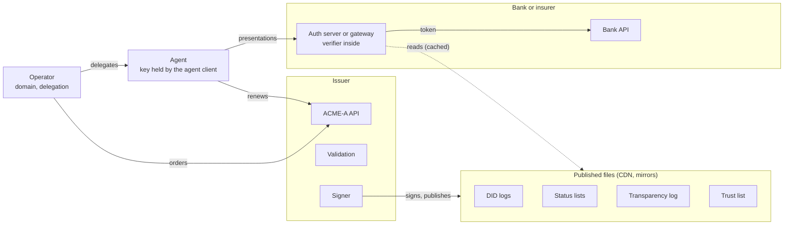

# Veridact: open specification for AI agent credentials

Version 0.2 · 9 November 2026 · [changes from v0.1](#changes-from-v01)

## Purpose and scope

Veridact issues short-lived W3C Verifiable Credentials to AI agents through an ACME-style protocol, so banks and insurers can verify which organisation operates an agent, and what it may do. This document is the open part of Veridact: the credential formats, identifiers, issuance protocol and verification rules that anyone can implement. Running an issuer is a separate, accredited service.

| Decision          | Choice                                                      | Reason                                                           |
|-------------------|-------------------------------------------------------------|------------------------------------------------------------------|
| Credential format | W3C VC Data Model 2.0, secured as JWT (VC-JOSE-COSE), ES256 | Works with existing API gateways, authorisation servers and HSMs |
| Identifiers       | did:webvh for issuers, operators and agents                 | No custom DID method; each operator controls its own identifiers |
| Issuance protocol | ACME (RFC 8555) profile, "ACME-A"                           | Proven automation model with mature client tooling               |

**Audience:** relying parties (banks, insurers and other APIs), agent operators, and anyone implementing an issuer or a verifier. **Out of scope:** identifying or biometrically enrolling natural persons, and payment authorisation. Customer consent stays with each bank's own authorisation server.

Veridact builds only on published standards: W3C DID v1.1, did:webvh, VC Data Model 2.0, VC-JOSE-COSE, Bitstring Status List, ACME (RFC 8555) and ARI (RFC 9773), OAuth token exchange (RFC 8693) and DPoP (RFC 9449).

## Architecture overview

Veridact has three planes, and relying parties never call an issuer's APIs to verify an agent. They read only public, cacheable artefacts, so verification keeps working through an issuance outage, and no issuer can see where agents are used.



The dashed line is the only link between relying parties and Veridact: cached reads of public files. Agents talk to Veridact to get credentials, and to relying parties to use them.

| Component                    | Plane        | Responsibility                                                                                                       |
|------------------------------|--------------|----------------------------------------------------------------------------------------------------------------------|
| ACME-A API                   | Issuance     | Accounts, orders, challenges, credential download, renewal                                                           |
| Validation workers           | Issuance     | Domain and delegation checks, from several network vantage points                                                    |
| Signer                       | Issuance     | The only component that can use issuer keys; signs credentials and status lists                                      |
| DID host                     | Publication  | Serves did:webvh logs for Veridact issuers and for Veridact-hosted agent DIDs                                        |
| Status service               | Publication  | Builds and signs Bitstring Status Lists for revocation and suspension                                                |
| Transparency log             | Publication  | Append-only, publicly auditable record of every credential issued                                                    |
| Trust registry               | Publication  | Signed list of accredited issuers, tiers, witnesses and policy parameters                                            |
| Verifier library and sidecar | Verification | Runs inside each relying party; verifies presentations with no call home                                             |
| Agent client (vbot)          | Agent side   | Holds the agent key, runs ACME-A orders, renews and fails over between issuers, builds presentations |

## Trust model

A relying party trusts an agent because a chain of signatures leads from the agent's key to an issuer that the trust registry lists for the required tier. Issuers vouch for organisations and the agents they operate; they never vouch for natural persons.

| Actor                       | Role                                                       | Trusts                                            |
|-----------------------------|------------------------------------------------------------|---------------------------------------------------|
| Operator                    | Organisation that runs agents and answers for them         | Veridact to validate it fairly                    |
| Agent                       | Software acting for the operator, holding its own key      | Its operator's delegation                         |
| Issuer                      | Validates operators, issues Operator and Agent Credentials | Governance policy and its own validation evidence |
| Relying party               | Bank or insurer API that decides whether to serve an agent | Issuers listed in the signed trust registry       |
| Governance authority        | Member consortium that accredits issuers and sets policy   | Its members and auditors                          |
| Monitor                     | Anyone watching the transparency log, usually operators    | The log's signed tree heads                       |

The chain a relying party checks, from the request inwards:

1.  The presentation is signed by the agent key published in the agent's DID.

2.  The Agent Credential binds that key to the agent DID, names the operator, and is signed by an accredited issuer.

3.  The Operator Credential, also in the presentation, records the validated domain and, at Organisation tier, the legal entity.

4.  The trust registry lists that issuer as accredited for the credential's tier.

| Tier                | What it proves                                                                            | Validation                                                                                   | Agent credential lifetime         |
|---------------------|-------------------------------------------------------------------------------------------|----------------------------------------------------------------------------------------------|-----------------------------------|
| Domain              | The agent is operated by whoever controls this domain                                     | Automated dns-01 or did-config-01 challenge                                                  | Default 8 hours, maximum 24 hours |
| Organisation        | The agent acts for a specific, legally registered company, under a named accountable role | Domain tier, plus a CIPC registration or vLEI check and review; re-validated every 12 months | Default 8 hours, maximum 24 hours |

When an agent acts for a bank customer, two separate authorities apply. Veridact says which software is calling and who answers for it. The bank's own authorisation server says what that customer allowed, and issues tokens bound to the agent's key (see Verification at the relying party).

Further tiers may be defined by the governance authority.

## Identifiers and keys

Every issuer, operator and agent gets a did:webvh 1.0 identifier, and every signing key is non-exportable from Organisation tier upwards. did:webvh maps an identifier to a signed, hash-chained log on a web domain: did:webvh:{SCID}:example.com resolves from https://example.com/.well-known/did.jsonl, and path segments become URL paths ([did:webvh spec](https://identity.foundation/didwebvh/next)).

| Identifier             | Pattern                                                       | Hosted at                                                                                                      |
|------------------------|---------------------------------------------------------------|----------------------------------------------------------------------------------------------------------------|
| Veridact issuer        | did:webvh:{SCID}:veridact.net:issuers:{tier}-{epoch}          | veridact.net, with at least two member-run witnesses                                                           |
| Operator               | did:webvh:{SCID}:{operator domain}                            | The operator's own domain                                                                                      |
| Agent, operator-hosted | did:webvh:{SCID}:{operator domain}:agents:{agent id}          | The operator's domain                                                                                          |
| Agent, Veridact-hosted | did:webvh:{SCID}:dids.veridact.net:{operator slug}:{agent id} | Veridact, for operators that cannot host DID logs; still bound to the operator through the Operator Credential |

Agent ids default to opaque random strings, because DIDs and the transparency log are public and descriptive names can leak business information.

| Key                       | Algorithm                                           | Custody                                                                          | Rotation                                                            |
|---------------------------|-----------------------------------------------------|----------------------------------------------------------------------------------|---------------------------------------------------------------------|
| Issuer credential signing | ES256 (P-256)                                       | HSM-backed, non-exportable, usable only by the signer       | Every 90 days, with a 30-day overlap in the trust registry          |
| Issuer DID update keys    | Ed25519 (eddsa-jcs-2022, required by did:webvh 1.0) | HSM or cloud KMS with EdDSA support                        | Pre-rotation via nextKeyHashes; next key generated and held offline |
| Operator DID update keys  | Ed25519                                             | Operator's KMS or HSM                                                            | Pre-rotation required at Organisation tier                          |
| Agent key                 | ES256 (P-256)                                       | Non-exportable: cloud KMS, TPM or HSM. Software keys allowed at Domain tier only | At most every 30 days, or on redeploy                               |
| ACME-A account key        | ES256                                               | Operator's secret store                                                          | On compromise or staff change                                       |

Pre-rotation means each DID log entry commits to the hash of the next update key. A thief who steals the current update key still cannot take over the identifier, because the next valid key is already fixed and held elsewhere. Witnesses co-sign issuer DID updates, so no single party, Veridact included, can silently rewrite an issuer's key history.

## Credential profiles

Veridact defines three credentials and one presentation, all W3C VC Data Model 2.0 documents secured as compact JWS per [VC-JOSE-COSE](https://www.w3.org/TR/vc-jose-cose/): the JWT claims set is the credential itself, typ is vc+jwt (presentations vp+jwt), and kid in the protected header names the signing key's DID URL. JWT iat and exp describe the signature and are set equal to validFrom and validUntil, so ordinary gateways can enforce expiry.

| Credential            | Issued by                                                          | Subject      | Key claims                                                                                                                                                    | Lifetime                                               |
|-----------------------|--------------------------------------------------------------------|--------------|---------------------------------------------------------------------------------------------------------------------------------------------------------------|--------------------------------------------------------|
| Operator Credential   | Veridact issuer                                                    | Operator DID | Validated domains, tier, legal entity name and CIPC number or LEI (Organisation tier), transparency log entry id, status entry                                 | 90 days at Domain tier, 12 months at Organisation tier |
| Delegation Credential | An approver appointed by the operator (two above R1,000 a payment) | Agent DID    | Scopes, delegation limits, accountable role (a role title, never a person's name), maximum lifetime, environment, optional allowed audiences                   | Up to 90 days                                          |
| Agent Credential      | Veridact issuer                                                    | Agent DID    | Operator DID and Operator Credential id, tier, scopes capped by tier policy, delegation limits, accountable role, key binding (cnf), status entry              | Default 8 hours, maximum 24 hours                      |
| Agent Presentation    | The agent                                                          | —            | holder (the agent DID), enveloped Agent and Operator Credentials, aud, nonce, iat, exp                                                                        | 120 seconds at most                                    |

An Agent Credential, decoded:

```
{
"alg": "ES256",
"typ": "vc+jwt",
"kid": "did:webvh:QmaT…:veridact.net:issuers:org-2026b#key-3"
}
.
{
"@context": ["https://www.w3.org/ns/credentials/v2", "https://veridact.net/ns/v1"],
"id": "urn:uuid:5f0c2d6e-8b1a-4c3e-9f27-1d4a6b8e0c55",
"type": ["VerifiableCredential", "VeridactAgentCredential"],
"issuer": "did:webvh:QmaT…:veridact.net:issuers:org-2026b",
"validFrom": "2026-10-20T08:00:00Z",
"validUntil": "2026-10-20T16:00:00Z",
"iat": 1792483200,
"exp": 1792512000,
"credentialSubject": {
"id": "did:webvh:QmX9…:operator.example:agents:a7f3k2",
"operator": "did:webvh:QmP4…:operator.example",
"operatorCredential": "urn:uuid:9d2e7a10-3c44-4b8f-a6e1-0f5b2c7d9e31",
"tier": "organisation",
"scopes": ["fs:claims:read-status", "fs:quotes:create"],
"accountableRole": "Head of Digital Claims",
"limits": { "currency": "ZAR", "perPayment": "500.00", "perDay": "2000.00" },
"cnf": { "kid": "did:webvh:QmX9…:operator.example:agents:a7f3k2#key-1" }
},
"credentialStatus": {
"type": "BitstringStatusListEntry",
"statusPurpose": "revocation",
"statusListIndex": "48213",
"statusListCredential": "https://status.veridact.net/org/2026-10/7"
}
}
```

Scopes come from a shared taxonomy that the governance authority owns, namespaced by sector (fs: for financial services). A relying party grants the intersection of the credential's scopes and its own policy, never more. Scopes outside the taxonomy are ignored, not treated as an error.

**Delegation limits.** limits carries the per-payment and daily limits from the Delegation Credential, capped by each approver's own ceiling. Amounts are decimal strings, so no implementation loses cents to binary floating point. An Agent Credential with no limits, or none in the payment's currency, gives the agent no authority to pay without a person.

**Status entries.** Both the Operator and the Agent Credential carry a BitstringStatusListEntry. Revoking either takes effect within 5 minutes; without one, a 12-month Organisation-tier Operator Credential would have no fast kill switch.

**The presentation** follows VC-JOSE-COSE. verifiableCredential is an array of EnvelopedVerifiableCredential objects whose id is a data: URL holding the credential's compact JWS. It carries exactly one Agent Credential and one Operator Credential; bare JWT strings are not accepted. kid in the protected header must be one of the holder DID's authentication keys. Decoded:

```
{
"alg": "ES256",
"typ": "vp+jwt",
"kid": "did:webvh:QmX9…:operator.example:agents:a7f3k2#key-1"
}
.
{
"@context": ["https://www.w3.org/ns/credentials/v2"],
"type": ["VerifiablePresentation"],
"holder": "did:webvh:QmX9…:operator.example:agents:a7f3k2",
"verifiableCredential": [
{ "@context": ["https://www.w3.org/ns/credentials/v2"], "type": "EnvelopedVerifiableCredential", "id": "data:application/vc+jwt,eyJhbGciOiJFUzI1NiIs…" },
{ "@context": ["https://www.w3.org/ns/credentials/v2"], "type": "EnvelopedVerifiableCredential", "id": "data:application/vc+jwt,eyJhbGciOiJFUzI1NiIs…" }
],
"aud": "https://api.bank.example",
"nonce": "9f2c41d0a7e3b5f8",
"iat": 1792483500,
"exp": 1792483560
}
```

Revocation uses Bitstring Status Lists of 131,072 entries, served as signed credentials (vc+jwt) from a CDN. Large lists give herd privacy: fetching one tells the issuer nothing about which agent a relying party is checking. Each list:

- names its own URL as its id, so one genuine list cannot be served in place of another;
- is signed by the same issuer as the credentials that point at it, with a key the trust list lists;
- is re-signed at least every 5 minutes, whether or not any bit changed, with exp no more than 4 hours after iat.

Verifiers measure a status list's age from its iat. A list mirrored or cached for an hour is an hour old, wherever it was fetched from, so the degraded-mode table (see Resilience) means the same thing everywhere and a stale mirror is detected. A verifier refuses a list older than one it has already accepted for the same URL.

## Delegation and human intent

An agent's authority flows down a chain of signatures, and nobody in the chain can give away more than they hold. People sit at the points that carry accountability; everything that can be checked mechanically runs without them.

1.  **The organisation appoints approvers.** An admin, signed in to the organisation's own identity system with a passkey, issues each approver an Approver Credential signed by the operator DID: a role title, a pseudonymous approver id, the scopes they may delegate and their own ceiling (for example R500 a payment). The issuer never sees a name.

2.  **An approver delegates to an agent.** They choose purpose, scopes, a per-payment limit, a daily limit and a lifetime of at most 90 days, read a plain-language summary, and sign it with their passkey. Single payments above R1,000 need a second, different approver.

3.  **The issuer checks the chain** before issuing the Agent Credential: each appointment is signed by the operator, each approver signed these exact terms, the scopes and limits are within each approver's own authority, and the two-person rule is met. It copies the scopes and limits into the Agent Credential.

4.  **The agent acts alone inside the limits.** Relying parties enforce the per-payment and daily limits from the Agent Credential's limits claim. The verifier keeps no ledger: the relying party supplies what it has already let the agent pay that day.

5.  **Outside the limits, a person decides.** The relying party returns ask_person with an intent request: the exact action, why it was stopped, and the agent's own note. It is routed to the lowest-ranked approver with enough authority. Their approval is signed over a hash of that exact action, is single-use, and expires after 5 minutes.

## Issuance protocol (ACME-A)

ACME-A is a profile of ACME ([RFC 8555](https://www.rfc-editor.org/rfc/rfc8555)) that keeps its accounts, orders, authorisations, JWS-signed requests and nonces, and adds one identifier type, two challenge types and a credential download in place of a certificate. Existing ACME client libraries can be extended rather than rewritten.

| Method and path           | Purpose                                             | Change from RFC 8555                                                                      |
|---------------------------|-----------------------------------------------------|-------------------------------------------------------------------------------------------|
| GET /directory            | Endpoint discovery, terms of service, tiers offered | Adds veridactTiers and trustList metadata                                                 |
| HEAD /new-nonce           | Anti-replay nonce for every POST                    | None                                                                                      |
| POST /new-account         | Register the operator's account key                 | Adds optional externalAccountBinding for Organisation tier contracts                      |
| POST /new-order           | Request a credential for identifiers                | New identifier type agent-did; dns used for operators                                     |
| POST /authz/{id}          | Fetch an authorisation and its challenges           | None                                                                                      |
| POST /chall/{id}          | Tell the issuer a challenge is ready                  | New challenge types below                                                                 |
| POST /order/{id}/finalize | Submit the key-binding proof and request issuance   | A signed key-binding JWT replaces the CSR                                                 |
| POST /cred/{id}           | Download the issued credential                      | Returns application/vc+jwt plus the transparency log receipt                              |
| POST /revoke-cred         | Revoke a credential                                 | Sets its status list bit instead of updating a CRL                                        |
| GET /renewal-info/{id}    | Suggested renewal window                            | ACME Renewal Information ([RFC 9773](https://rfc-editor.org/rfc/rfc9773.html)), unchanged |

| Challenge           | Proves                                        | How it is checked                                                                                                              |
|---------------------|-----------------------------------------------|--------------------------------------------------------------------------------------------------------------------------------|
| dns-01              | Control of the operator's domain              | Standard: a TXT record at \_acme-challenge.{domain} holding the key-authorisation digest                                       |
| did-config-01 (new) | The operator's DID and domain belong together | A Domain Linkage Credential at https://{domain}/.well-known/did-configuration.json, signed by the operator DID                 |
| delegation-01 (new) | The operator authorised this agent            | A Delegation Credential signed by an operator DID that holds a valid Operator Credential, with scopes inside the tier's policy |

Domain checks run from at least three network vantage points, and all must agree, so that a local DNS or routing hijack cannot mint an Operator Credential. An optional \_veridact.{domain} TXT record pins which ACME-A accounts may order for the domain, much as a CAA record does for certificates.

**Operator onboarding**, done once and renewed every 90 days or 12 months:

1.  The operator registers an account key with new-account.

2.  It orders a dns identifier for its domain and completes dns-01.

3.  It publishes its did:webvh log and Domain Linkage Credential, then completes did-config-01.

4.  At Organisation tier, a reviewer matches the CIPC registration or vLEI to the domain owner before issuance.

5.  The issuer issues the Operator Credential and logs it.

**Agent issuance**, automated and repeated every few hours:

1.  The agent client generates the agent key in KMS, TPM or HSM and publishes the agent's DID.

2.  It orders an agent-did identifier and submits the operator's Delegation Credential to delegation-01.

3.  At finalize it sends a key-binding JWT, signed by the agent key over the order URL and a fresh nonce.

4.  The issuer checks the delegation, the operator's credential status, tier policy and the proof of possession, then signs the Agent Credential.

5.  The credential is appended to the transparency log before it is released, and the download carries the log receipt.

6.  The client renews at the window that renewal-info suggests, by default two thirds through the lifetime.

Rate limits apply per account and per operator domain, so a compromised account cannot flood the log.

## Verification at the relying party

The recommended integration is a token exchange at the bank's existing authorisation server: the agent trades one verified presentation for a short-lived, key-bound access token, so downstream APIs see only the JWTs they already accept. Direct verification at the API gateway suits relying parties without an authorisation server in the agent path.

| Pattern                         | How it works                                                                                                                                                                                                                                                                                                                                                                            | Fits                                                                               |
|---------------------------------|-----------------------------------------------------------------------------------------------------------------------------------------------------------------------------------------------------------------------------------------------------------------------------------------------------------------------------------------------------------------------------------------|------------------------------------------------------------------------------------|
| A. Token exchange (recommended) | The agent sends its presentation as the subject_token of an OAuth token exchange ([RFC 8693](https://www.rfc-editor.org/rfc/rfc8693)). The authorisation server verifies it through the Veridact sidecar and issues a DPoP-bound access token ([RFC 9449](https://www.rfc-editor.org/rfc/rfc9449)) whose scopes are the agent's scopes intersected with policy and any customer consent | Banks with PingFederate, Entra or similar in front of their APIs                   |
| B. Gateway verification         | The API returns 401 with a nonce; the agent retries with Authorization: Veridact vp="\<VP-JWT\>"; a gateway authoriser verifies it                                                                                                                                                                                                                                                      | AWS API Gateway (Lambda authoriser), Kong or Envoy without an authorisation server |

The challenge in pattern B:

HTTP/1.1 401 Unauthorized  
WWW-Authenticate: Veridact realm="claims-api", nonce="9f2c41d0a7e3b5f8", tier="organisation", scope="fs:claims:read-status"

The verifier library runs these checks in order and stops at the first failure. All signatures are ES256; a verifier refuses any other alg before going further.

1.  The presentation is a compact JWS with typ vp+jwt, its aud is or includes this relying party, and its nonce was issued here and is still live. Its lifetime, exp minus iat, is at most 120 seconds, and the current time is no later than exp. Verifiers allow a configurable clock skew, 30 seconds by default. This check does not consume the nonce.

2.  Resolve the holder's DID, verify its did:webvh log (hash chain, SCID, proofs and pre-rotation), and verify the presentation signature with the authentication key its kid names. Only then consume the nonce, atomically, so nobody can burn a nonce with a junk presentation and two parallel replays cannot both succeed.

3.  Extract the enveloped Agent and Operator Credentials and check each signature with an assertionMethod key of its issuer DID. Before resolving an issuer DID, confirm that the trust list names the issuer. If it does not, stop with check 4's result. This stops a presentation from making the verifier fetch arbitrary URLs.

4.  Check that the trust registry accredits each issuer for the credential type and tier, and lists the signing key for the credential's iat (see Trust registry).

5.  Check validity windows, that iat and exp equal validFrom and validUntil, and lifetimes against the trust list's maxima. Check the status entries of both credentials, and apply degraded-mode policy to the status lists' age.

6.  Check that the Agent Credential's subject is the presentation's holder, and its cnf key signed the presentation.

7.  Check that the Agent Credential's operator and operatorCredential match the Operator Credential's subject and id, and that the Agent Credential's tier does not rank above the Operator Credential's.

8.  Apply relying-party policy: minimum tier, allowed operators, scopes requested against scopes held, and, for payments, the delegation limits.

The library caches DID logs and status lists for up to 5 minutes, and the trust registry for an hour; with a warm cache it makes no network calls. A file that fails verification is never cached, so a tampered mirror cannot displace a good copy. When a status list cannot be refreshed, behaviour follows the relying party's degraded-mode policy rather than a single fail-closed rule (see Resilience).

**For relying parties:** [veridact-verify](../verify), the reference verifier library, and [conformance vectors](../conformance) for other implementations. Planned: the same library packaged as an HTTP sidecar with a /verify endpoint for other stacks, and reference integrations for an API gateway authoriser and a token-exchange handler.

## Decisions and reason codes

**Explainable decisions.** Every verification returns a decision (allow, deny, ask_person or challenge) with reason codes. The relying party's logs get the full explanation; the caller gets only the first actionable public code, so an attacker learns nothing about which cryptographic check failed.

| Public code                      | Meaning                                      | What the caller should do                      |
|----------------------------------|----------------------------------------------|------------------------------------------------|
| CHALLENGE_REQUIRED               | Nonce missing, expired or reused, or presentation expired | Fetch a new challenge                          |
| CREDENTIAL_EXPIRED               | Outside its validity window                  | Renew; vbot does this automatically            |
| ISSUER_UNTRUSTED                 | Issuer not accredited for this relying party | Obtain a credential from an accredited issuer  |
| TIER_TOO_LOW                     | Operator's tier below the route's minimum    | Upgrade the operator's tier                    |
| OPERATOR_NOT_ALLOWED             | The relying party does not accept this operator | Arrange onboarding with the relying party   |
| SCOPE_NOT_HELD                   | Agent lacks the required scope               | Ask the operator to delegate it                |
| LIMIT_PER_PAYMENT, LIMIT_PER_DAY | Outside the delegation's limits              | request_intent: a person decides               |
| VERIFICATION_UNAVAILABLE         | The trust list, a DID log or a status list could not be fetched and no usable cached copy exists, or degraded-mode policy blocks the action | Retry later                                    |
| AUTH_FAILED                      | Any signature, tampering or binding failure, and any revoked or suspended credential | None; details stay in the relying party's logs |

Revocation and suspension deliberately return AUTH_FAILED. The operator already knows why its agent was revoked, and telling an attacker that a stolen credential has been revoked helps the attacker more than the operator.

Advisory risk signals, such as operator age and revocation history, can be passed to the bank's fraud engine alongside the decision. They never override a cryptographic result, and there is no single trust score: a score cannot show a regulator who authorised an action.

## Transparency log and revocation

Every Operator and Agent Credential is appended to a public, append-only Merkle log before it is released, so an operator can see every credential issued in its name and an issuer cannot issue one secretly. The design follows Certificate Transparency v2 ([RFC 9162](https://www.rfc-editor.org/rfc/rfc9162)).

- **Entries:** the credential's SHA-256 hash, issuer, subject DID, operator domain, tier, scopes and validity. The full credential is not published.

- **Storage:** a tile-based log on write-once storage, so nobody, the log operator included, can delete or rewrite entries during the retention period.

- **Signed tree heads** are published every 60 seconds and co-signed by member-run witnesses, which stops the log showing different histories to different parties.

- **Receipts:** each credential download includes an inclusion proof. Relying parties may require one at Organisation tier and above.

- **Monitoring:** operators subscribe to their domains and are alerted within minutes of any issuance in their name, so they can revoke it at once.

| Who can revoke           | How                                                                        | Typical reason                                    |
|--------------------------|----------------------------------------------------------------------------|---------------------------------------------------|
| The operator             | revoke-cred with its account key, or by revoking the Delegation Credential | Agent decommissioned, key compromised             |
| The issuer               | Signer sets the status bit, recorded in the audit log                      | Policy breach, mis-issuance, failed re-validation |
| The governance authority | Instruction to the issuer under the framework                                | Accreditation withdrawn                           |

A revocation of an Agent or an Operator Credential is visible in the published status list within 5 minutes. Short lifetimes do most of the work: an agent that is not renewed stops being valid within hours, without anyone revoking it.

In the target state every credential is logged in at least two transparency logs run by different operators, as Certificate Transparency requires for web certificates, so one log outage does not stop issuance.

## Trust registry and governance hooks

The trust registry is the root that relying parties configure: a signed list of which issuers may issue which credentials at which tier, plus the policy parameters every component reads. Changing governance therefore changes a published, versioned document, not code.

- **Format:** a JWS-signed trust list at https://trust.veridact.net/trust-list.jwt, signed by keys the governance authority controls, held separately from any issuer's keys.

- **Contents:** accredited issuer DIDs with their tiers and key epochs, accredited Organisation-tier validators, transparency log witnesses, the scope taxonomy, and policy parameters such as maximum lifetimes and challenge rules.

- **Query API:** GET /v1/entities/{did}/authorization?action=issue&resource=VeridactAgentCredential&tier=organisation, modelled on the Trust over IP Trust Registry Query Protocol, for relying parties that prefer a lookup to a downloaded list.

- **Change control:** governance publishes each policy version with an effective date at least 14 days ahead, so components and relying parties can prepare. Emergency changes, such as removing a compromised issuer, take effect at once.

This split keeps issuers honest: issuers run issuance, but the members decide whom relying parties trust. Removing an issuer from the list invalidates everything it issued, everywhere, within the trust-list cache period.

### Trust list format

The trust list is a compact JWS with typ trust-list+jwt and alg ES256. Its kid names a governance key that each relying party pins as a JWK in its own configuration. The key is never resolved through a DID, so compromising a DID host or a CDN cannot change the root. Payload:

```
{
"iss": "https://trust.veridact.net",
"version": "2026.11.1",
"iat": 1794124800,
"exp": 1794816000,
"issuers": [{
"id": "did:webvh:QmaT…:veridact.net:issuers:org-2026b",
"tiers": ["domain", "organisation"],
"credentialTypes": ["VeridactAgentCredential", "VeridactOperatorCredential"],
"keys": [{ "kid": "did:webvh:QmaT…:veridact.net:issuers:org-2026b#key-3", "notBefore": 1789027200, "notAfter": 1796803200 }]
}],
"scopes": ["fs:claims:read-status", "fs:quotes:create", "fs:payments:initiate"],
"policy": {
"tierOrder": ["domain", "organisation"],
"agentCredentialMaxLifetime": 86400,
"presentationMaxLifetime": 120,
"operatorCredentialMaxLifetime": { "domain": 7776000, "organisation": 31622400 }
}
}
```

Verifiers apply these rules:

- **Key epochs.** notBefore and notAfter bound when a key may sign. A credential or status list is accepted only if its iat falls inside its signing key's window. This lets a 12-month Operator Credential outlive the 90-day key rotation. Removing a key from the list, for example after compromise, invalidates everything it signed.
- **Rollback.** A verifier refuses a list whose iat is older than one it has already accepted, so a stale mirror cannot restore a removed issuer.
- **Stale use.** A cached list may be used after a failed refresh until its own exp, never beyond.
- **Scopes.** Credential scopes outside scopes are dropped.
- **Tiers.** tierOrder ranks tiers from lowest to highest, for minimum-tier checks.
- **Emergency lifetime extension** is a change to agentCredentialMaxLifetime.

Accredited validators, transparency log witnesses and challenge rules will be added to this schema when verifiers use them.

### Issuer accreditation

The trust registry can list many issuers. A member that wants its own issuer runs one on the same open protocol and is accredited by the governance authority; every relying party then recognises its credentials. Accreditation requires:

- Issuer keys in an HSM, with dual control and the same rotation rules as every other issuer

- ACME-A conformance, verified against a published test suite before listing

- Logging every credential to at least two accredited transparency logs

- Validation evidence kept for every Operator Credential at Organisation tier, available for member audit

- An annual independent audit and an incident-notification commitment to the governance authority

- A tested plan for revoking or winding down everything it has issued

Accreditation is per tier, so a member can begin by issuing Agent Credentials to its own agents and add other tiers later.

## Security and threat model

The most damaging failure is a stolen or misused issuer key, because it would let an attacker mint trusted agents for any operator; most controls below exist to make that impossible or immediately visible.

| Threat                                | Impact                                                     | Mitigations                                                                                                                                                                                       |
|---------------------------------------|------------------------------------------------------------|---------------------------------------------------------------------------------------------------------------------------------------------------------------------------------------------------|
| Issuer key compromise                 | Forged credentials across the ecosystem                    | Non-exportable HSM-backed keys in an isolated account, single signing path, dual control for key operations, 90-day rotation, every issuance logged, issuer removable from the trust list at once |
| Insider mis-issuance at an issuer     | Credentials for an operator that never asked               | Issuance only through ACME-A with recorded validation evidence; transparency log alerts the real operator; member audits                                                                          |
| Domain validation spoofing            | Operator Credential for a domain the attacker does not own | Checks from three or more vantage points, DNSSEC validation where signed, optional \_veridact account pinning                                                                                     |
| Agent key theft                       | Impersonation of a legitimate agent                        | Non-exportable keys at Organisation tier and above, hours-long credentials, DPoP-bound tokens, operator revocation                                                                                |
| Over-broad delegation                 | Agent acts outside its intended purpose                    | Scope taxonomy with per-tier caps, relying parties grant only the intersection with their policy                                                                                                  |
| Presentation replay                   | Reuse of a captured presentation                           | Relying-party nonce, aud binding, 120-second expiry, used-nonce cache                                                                                                                             |
| Log equivocation                      | Hidden issuance shown to some parties only                 | Witness co-signed tree heads; operators and members monitor independently                                                                                                                         |
| Denial of service on public artefacts | Verification outages                                       | Static CDN delivery with Shield and WAF, client caches with bounded stale use                                                                                                                     |
| Supply chain compromise               | Malicious code in Veridact or the agent client             | Pinned dependencies, signed images, software bill of materials, reproducible builds for the verifier library                                                                                      |

## Privacy and POPIA

An issuer holds almost no personal information by design: credentials and the transparency log describe organisations and software, and the only personal data is operator administrators' contact details, kept in South Africa.

| Data                                         | Personal information?                         | Handling                                                                                                                             |
|----------------------------------------------|-----------------------------------------------|--------------------------------------------------------------------------------------------------------------------------------------|
| Operator admin contacts (name, email, phone) | Yes                                           | Stored in South Africa only; used for account security and incident notices; deleted after the retention period that legal review sets |
| Credentials, DIDs, transparency log          | No: organisations, roles and opaque agent ids | Public by design; the accountable role is a title, never a name                                                                      |
| Customer identity and consent                | Never held                                    | Stays in each bank's own systems and authorisation server                                                                            |
| Verification events                          | Not collected                                 | Verification runs inside the relying party; status lists are large, so fetching one does not reveal which agent was checked          |

Public artefacts may be cached worldwide by a CDN because they contain no personal information.

## Resilience

No single operator, no single issuer included, can switch the network off: verification runs inside each relying party on signed, mirrorable files, and issuance can fail over to other accredited issuers. A full Veridact outage degrades service over hours, not seconds.

| Component down                               | Effect                                                                          | Continuity measure                                                                                                    |
|----------------------------------------------|---------------------------------------------------------------------------------|-----------------------------------------------------------------------------------------------------------------------|
| Veridact issuance                            | Agents cannot renew from Veridact; existing credentials stay valid until expiry | Agent client fails over to a second accredited issuer; first lapses would otherwise start about 2 hours 40 minutes in |
| Publication (DIDs, status lists, trust list) | Verifiers run on cached copies                                                  | Several CDNs plus member-run mirrors; signed files can be served by anyone without losing trust                  |
| One transparency log                         | Issuance to that log pauses                                                     | Credentials logged to two independent logs; issuance continues on the other                                           |
| Signer or issuer key                         | Veridact cannot sign                                                            | Other accredited issuers keep issuing; a compromised issuer is removed from the trust list                            |
| All of Veridact                              | Network runs on member issuers, logs and mirrors                                | Veridact acts as coordinator and default operator, not the single point of failure                                    |

**Degraded-mode policy.** Each relying party sets how its verifier behaves when status lists go stale. Age is measured from the list's iat; because issuers re-sign every 5 minutes, a list older than that means publication has stalled somewhere between the issuer and the verifier. The default:

| Status list age          | Low-risk actions       | Medium-risk actions                     | High-risk actions         |
|--------------------------|------------------------|-----------------------------------------|---------------------------|
| Up to 5 minutes (normal) | Allow                  | Allow                                   | Allow                     |
| 5 minutes to 4 hours     | Allow on cached status | Allow on cached status, flag for review | Block until fresh         |
| Over 4 hours             | Block                  | Block                                   | Block                     |

**Member mirrors.** A member can run a local mirror of the trust list, DID logs, status lists and log tiles inside its own network. The mirror pulls signed updates whenever Veridact or another mirror is reachable, and the verifier library reads from it first. Because every file is signed, a tampered mirror is detected, not trusted.

**Dual issuance.** The agent client can hold Agent Credentials from two accredited issuers at once and present either. Relying parties accept any issuer the trust registry lists for the tier, so failover needs no change on their side.

**Emergency lifetime extension.** During a declared incident or before planned maintenance, the governance authority can raise the maximum agent credential lifetime, for example from 8 to 24 hours, through the trust list. Longer lifetimes buy recovery time at the cost of slower revocation, which is why the decision sits with governance rather than the operator.

## Changes from v0.1

v0.2 settles the gaps found while building the reference verifier ([proposal](proposals/0.2-verifier-gaps.md)):

1. The Agent Credential carries delegation limits (limits), and no limits means no authority to pay alone.
2. The Operator Credential carries a status entry, revocable within 5 minutes.
3. The trust list has a normative format, with key epochs, rollback protection and bounded stale use.
4. The presentation's encoding is specified: holder plus EnvelopedVerifiableCredential data: URLs.
5. New public codes: VERIFICATION_UNAVAILABLE and OPERATOR_NOT_ALLOWED.
6. Revoked and suspended credentials return AUTH_FAILED.
7. Status lists name their own URL, are re-signed at least every 5 minutes with exp no more than 4 hours after iat, and their age is measured from iat.
8. A verifier confirms the trust list names an issuer before resolving the issuer's DID.
9. The nonce is consumed only after the presentation signature verifies.
10. An Agent Credential's tier may not rank above its Operator Credential's.

Also: grammar fix in Trust model, and check 1's 120-second rule stated as exp − iat ≤ 120 with a clock-skew allowance.

## Sources

- [The did:webvh DID Method, editor's draft (DIF)](https://identity.foundation/didwebvh/next): DID-to-URL mapping, eddsa-jcs-2022, pre-rotation, witnesses, SCID derivation

- [Securing Verifiable Credentials using JOSE and COSE (W3C)](https://www.w3.org/TR/vc-jose-cose/): vc+jwt and vp+jwt media types, enveloped credentials, iat and exp semantics


- [RFC 9773, ACME Renewal Information](https://rfc-editor.org/rfc/rfc9773.html)

IETF RFCs 8555, 8693, 9449, 9162 and 8785 are linked where they are used and were not re-read for this draft.
