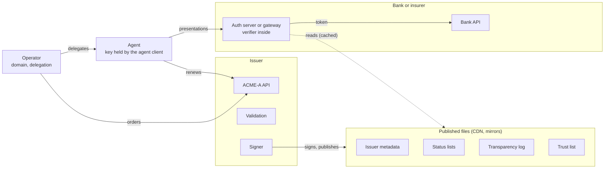

# Veridact: open specification for AI agent credentials

Version 0.5 · 22 November 2026 · [changes from v0.4](#changes-from-v04) · [changes from v0.3](#changes-from-v03) · [changes from v0.2](#changes-from-v02) · [changes from v0.1](#changes-from-v01)

## Purpose and scope

Veridact issues short-lived credentials to AI agents through an ACME-style protocol, so banks and insurers can verify which organisation operates an agent, and what it may do. It also publishes credentials about mainstream AI assistants (known-assistant entries), so a bank can identify and withdraw them without their platforms taking part. This document is the open part of Veridact: the credential formats, identifiers, issuance protocol and verification rules that anyone can implement. Running an issuer is a separate, accredited service.

| Decision          | Choice                                                                | Reason                                                                                   |
|-------------------|-----------------------------------------------------------------------|------------------------------------------------------------------------------------------|
| Credential format | SD-JWT VC ([draft-ietf-oauth-sd-jwt-vc](https://datatracker.ietf.org/doc/draft-ietf-oauth-sd-jwt-vc/)), ES256 | Every artefact is a JWT a bank's authorisation server, gateway and HSM already handle; selective disclosure |
| Identifiers       | HTTPS URLs; agents are OAuth clients with Client ID Metadata Documents | The agent's client_id at a bank is also its Veridact identifier; no DID resolver         |
| Revocation        | Token Status List ([draft-ietf-oauth-status-list](https://datatracker.ietf.org/doc/draft-ietf-oauth-status-list/)) | Compact, cacheable, herd-private, and an IETF OAuth working group format |
| Issuance protocol | ACME (RFC 8555) profile, "ACME-A"                                      | Proven automation model with mature client tooling                                       |

**Audience:** relying parties (banks, insurers and other APIs), agent operators, and anyone implementing an issuer or a verifier. **Out of scope:** identifying or biometrically enrolling natural persons, and payment authorisation. Customer consent stays with each bank's own authorisation server.

Veridact builds only on published standards: SD-JWT ([RFC 9901](https://www.rfc-editor.org/rfc/rfc9901)) and SD-JWT VC, the Token Status List, JWT VC Issuer Metadata, OAuth Client ID Metadata Documents, OAuth attestation-based client authentication, ACME (RFC 8555) and ARI (RFC 9773), OAuth token exchange (RFC 8693), DPoP (RFC 9449), JWK thumbprints (RFC 7638), mutual-TLS client authentication and certificate-bound tokens (RFC 8705), X.509 (RFC 5280), time-stamping (RFC 3161) and evidence records (RFC 4998).

## Architecture overview

Veridact has three planes, and relying parties never call an issuer's APIs to verify an agent. They read only public, cacheable artefacts, so verification keeps working through an issuance outage, and no issuer can see where agents are used.



The dashed line is the only link between relying parties and Veridact: cached reads of public files. Agents talk to Veridact to get credentials, and to relying parties to use them.

| Component                    | Plane        | Responsibility                                                                                                       |
|------------------------------|--------------|----------------------------------------------------------------------------------------------------------------------|
| ACME-A API                   | Issuance     | Accounts, orders, challenges, credential download, renewal, key events                                               |
| Validation workers           | Issuance     | Domain, operator-key, client-metadata and delegation checks, from several network vantage points                     |
| Signer                       | Issuance     | The only component that can use issuer keys; signs credentials and status lists                                      |
| Metadata host                | Publication  | Serves each issuer's JWT VC Issuer Metadata, Veridact-hosted agent Client ID Metadata Documents, and known-assistant entries |
| Status service               | Publication  | Builds and signs Token Status Lists for revocation and suspension                                                    |
| Transparency log             | Publication  | Append-only, publicly auditable record of every credential issued and every key event                                |
| Trust registry               | Publication  | Signed list of accredited issuers, their pinned keys, tiers, witnesses and policy parameters                         |
| Verifier library and sidecar | Verification | Runs inside each relying party; verifies presentations with no call home                                             |
| Agent client (vbot)          | Agent side   | Holds the agent key, runs ACME-A orders, renews and fails over between issuers, builds presentations                 |

## Trust model

A relying party trusts an agent because a chain of signatures leads from the agent's key to an issuer that the trust registry lists for the required tier. Issuers vouch for organisations and the agents they operate; they never vouch for natural persons.

| Actor                       | Role                                                       | Trusts                                            |
|-----------------------------|------------------------------------------------------------|---------------------------------------------------|
| Operator                    | Organisation that runs agents and answers for them         | Veridact to validate it fairly                    |
| Agent                       | Software acting for the operator, holding its own key      | Its operator's delegation                         |
| Issuer                      | Validates operators, issues Operator and Agent Credentials | Governance policy and its own validation evidence |
| Relying party               | Bank or insurer API that decides whether to serve an agent | Issuers listed in the signed trust registry       |
| Governance authority        | Member consortium that accredits issuers and sets policy   | Its members and auditors                          |
| Monitor                     | Anyone watching the transparency log, usually operators    | The log's signed tree heads                       |

The chain a relying party checks, from the request inwards:

1.  The Key Binding JWT is signed by the key the Agent Credential's cnf names, for this relying party and this nonce.

2.  The Agent Credential binds that key to the agent's URL, names the operator, carries the operator facts the relying party needs, and is signed by an accredited issuer with a key the trust list pins.

3.  The Agent Credential points at its own status entry and at the Operator Credential's, so revoking the operator stops all its agents.

4.  The trust registry lists that issuer as accredited for the credential's vct and tier.

| Tier                | What it proves                                                                            | Validation                                                                                   | Agent credential lifetime         |
|---------------------|-------------------------------------------------------------------------------------------|----------------------------------------------------------------------------------------------|-----------------------------------|
| Domain              | The agent is operated by whoever controls this domain                                     | Automated dns-01 or operator-keys-01 challenge                                               | Default 8 hours, maximum 24 hours |
| Organisation        | The agent acts for a specific, legally registered company, under a named accountable role | Domain tier, plus a CIPC registration or vLEI check and review; re-validated every 12 months | Default 8 hours, maximum 24 hours |

When an agent acts for a bank customer, two separate authorities apply. Veridact says which software is calling and who answers for it. The bank's own authorisation server says what that customer allowed, and issues tokens bound to the agent's key (see Verification at the relying party).

Further tiers may be defined by the governance authority.

## Identifiers and keys

Every issuer, operator and agent is named by an HTTPS URL. Each URL serves the public keys of whoever it names, and the transparency log records every change to an operator's or agent's keys, so a key served from a URL counts only if the log has it.

| Party                  | Identifier                                  | Keys published at                                                                                        |
|------------------------|---------------------------------------------|----------------------------------------------------------------------------------------------------------|
| Veridact issuer        | https://veridact.net/issuers/{tier}-{epoch} | JWT VC Issuer Metadata: https://veridact.net/.well-known/jwt-vc-issuer/issuers/{tier}-{epoch}, with jwks embedded. The trust list pins the same keys by thumbprint |
| Operator               | https://{operator domain}                   | https://{operator domain}/.well-known/veridact-operator.json: operator (the URL itself), jwks (delegation-signing keys), and optionally the agent URL prefixes it runs |
| Agent, operator-hosted | https://{operator domain}/agents/{agent id} | The URL serves a Client ID Metadata Document ([draft-ietf-oauth-client-id-metadata-document](https://datatracker.ietf.org/doc/draft-ietf-oauth-client-id-metadata-document/)) whose jwks hold the agent's keys |
| Agent, Veridact-hosted | {agent hosting}/{account slug}/{agent id}, for example https://agents.veridact.net/{slug}/{id} | A Client ID Metadata Document served by the issuer (veridactAgentHosting in its directory), for operators that cannot host one; still bound to the operator through its account and Operator Credential |

**Agents are OAuth clients.** An agent's identifier is a Client ID Metadata Document URL. client_id in the document equals the URL, compared as a plain string; jwks holds the agent's authentication keys; token_endpoint_auth_methods_supported includes attest_jwt_client_auth_dpop, plus private_key_jwt where the agent uses it. The same URL is the sub of the Agent Credential and the client_id at every bank.

Agent ids and account slugs are opaque random strings, because the documents and the transparency log are public and descriptive names can leak business information. Keys are named by their JWK thumbprint ([RFC 7638](https://www.rfc-editor.org/rfc/rfc7638)) everywhere a kid is needed, except issuer keys, which carry the kid their metadata gives them.

These patterns are normative for issuers. An issuer accepts an operator only as https://{domain} for a domain the order validates, and an agent only under one of the operator's validated domains (/agents/{agent id}) or under the ordering account's own slug on the issuer's agent hosting. A domain cannot vouch for an agent hosted elsewhere.

**Key events.** A key-event log entry records the subject (an operator or agent URL), the key thumbprint, the action (add, retire or compromise) and the time. The issuer appends one before the key takes effect: when it first accepts an operator's delegation key or an agent's key, and when the operator retires or reports a compromised key through ACME-A. A key that has been retired or compromised never returns. When a retire or compromise event is logged, the issuer revokes every credential that names the key at once. Monitors alert the operator within minutes of any key event for its domain. A thief who edits a hosted document still cannot get a new key accepted without an ACME-A request from the operator's account, and that request is logged.

| Key                       | Algorithm                                           | Custody                                                                          | Rotation                                                            |
|---------------------------|-----------------------------------------------------|----------------------------------------------------------------------------------|---------------------------------------------------------------------|
| Issuer credential signing | ES256 (P-256)                                       | HSM-backed, non-exportable, usable only by the signer                            | Every 90 days, with a 30-day overlap in the trust registry          |
| Operator delegation key   | ES256 (P-256)                                       | Operator's KMS or HSM; non-exportable at Organisation tier                       | Through key events; the old key's Operator Credential is revoked    |
| Agent key                 | ES256 (P-256)                                       | Non-exportable: cloud KMS, TPM or HSM. Software keys allowed at Domain tier only | At most every 30 days, or on redeploy, through key events           |
| Agent TLS key (optional)  | ES256 (P-256)                                       | As the agent key; may be the agent key itself (see Agent Certificates)           | As the agent key                                                    |
| Sub-agent key             | ES256 (P-256)                                       | Held by the sub-agent; never published                                           | Per sub-agent, discarded when its grant expires                     |
| Issuer Agent CA key       | ES256 (P-256)                                       | HSM-backed, non-exportable, usable only by the signer                            | Every 90 days, with a 30-day overlap in the trust registry          |
| ACME-A account key        | ES256                                               | Operator's secret store                                                          | On compromise or staff change                                       |

Issuer keys are listed only in the governance-signed trust list, which has witnesses and an overlap period, so no single party, Veridact included, can silently change an issuer's keys.

## Credential profiles

Every credential is an SD-JWT VC: an issuer-signed JWT with typ dc+sd-jwt, alg ES256 and kid naming the issuer key, followed by its disclosures (`<JWT>~<disclosure>~…~`). Claims marked (SD) are selectively disclosable: the issuer signs only their SHA-256 digests in _sd, and the holder decides which to reveal. iat, nbf and exp carry the validity window in clear, so ordinary gateways can enforce expiry. Claim names are snake_case; amounts are decimal strings.

| Credential | vct | Issued by | sub | Claims | Lifetime |
|---|---|---|---|---|---|
| Operator Credential | https://veridact.net/vct/operator/v1 | Issuer | Operator URL | tier, domains, log_entry, cnf (the operator's delegation key), status; (SD) legal_name, registration (CIPC number or LEI), jurisdiction | 90 days at Domain tier, 12 months at Organisation tier |
| Approver Credential | https://veridact.net/vct/approver/v1 | Operator | Pseudonymous approver id | role, scopes, ceiling, cnf (the approver's passkey-backed key) | Set by the operator |
| Delegation Credential | https://veridact.net/vct/delegation/v1 | An approver appointed by the operator (two above R1,000 a payment) | Agent URL | scopes, limits, accountable_role (a role title, never a person's name), max_lifetime, environment, optional audiences and certificate_max_lifetime | Up to 90 days |
| Agent Credential | https://veridact.net/vct/agent/v1 | Issuer | Agent URL | operator, operator_credential (its jti), operator_status (the Operator Credential's status reference), tier, scopes capped by tier policy, limits, accountable_role, cnf.jwk, cnf_event, status; (SD) operator_legal_name, operator_registration, operator_jurisdiction | Default 8 hours, maximum 24 hours |
| Known-Assistant Credential | https://veridact.net/vct/known-assistant/v1 | Issuer | Platform identifier | See Known-assistant entries | Up to 90 days |
| Agent Presentation | — | The agent | — | The Agent Credential, the disclosures the agent chooses, and a Key Binding JWT | 120 seconds at most |

**The Agent Credential carries the operator facts a relying party needs**, copied and signed by the issuer at issuance, so a presentation does not carry the Operator Credential. The relying party checks two status entries: status for the agent, and operator_status for the operator. cnf_event names the transparency log entry of the cnf key's add event.

An Agent Credential's issuer-signed part, decoded:

```
{ "alg": "ES256", "typ": "dc+sd-jwt", "kid": "org-2026b-3" }
.
{
"iss": "https://veridact.net/issuers/org-2026b",
"vct": "https://veridact.net/vct/agent/v1",
"jti": "urn:uuid:5f0c2d6e-8b1a-4c3e-9f27-1d4a6b8e0c55",
"sub": "https://operator.example/agents/a7f3k2",
"iat": 1792483200, "nbf": 1792483200, "exp": 1792512000,
"operator": "https://operator.example",
"operator_credential": "urn:uuid:9d2e7a10-3c44-4b8f-a6e1-0f5b2c7d9e31",
"operator_status": { "status_list": { "idx": 9123, "uri": "https://status.veridact.net/org/operators/2" } },
"tier": "organisation",
"scopes": ["fs:claims:read-status", "fs:quotes:create"],
"accountable_role": "Head of Digital Claims",
"limits": { "currency": "ZAR", "per_payment": "500.00", "per_day": "2000.00" },
"cnf": { "jwk": { "kty": "EC", "crv": "P-256", "x": "…", "y": "…" } },
"cnf_event": "veridact-log-2026/000004812",
"status": { "status_list": { "idx": 48213, "uri": "https://status.veridact.net/org/agents/7" } },
"_sd": ["…", "…", "…", "…", "…"], "_sd_alg": "sha-256"
}
```

Issuers add decoy digests to _sd, so the number of digests says nothing about which claims a credential holds. A disclosure that names a claim already signed in clear, appears twice, or is not referenced by the signed payload is invalid. iss, vct, sub, jti, iat, nbf, exp, cnf, status, _sd and _sd_alg are never selectively disclosable.

Scopes come from a shared taxonomy that the governance authority owns, namespaced by sector (fs: for financial services). A relying party grants the intersection of the credential's scopes and its own policy, never more. Scopes outside the taxonomy are ignored, not treated as an error.

**Delegation limits.** limits carries the per-payment and daily limits from the Delegation Credential, capped by each approver's own ceiling. Amounts are decimal strings, so no implementation loses cents to binary floating point. An Agent Credential with no limits, or none in the payment's currency, gives the agent no authority to pay without a person.

**Status references.** Both the Operator and the Agent Credential carry a status reference, {"status_list": {"idx", "uri"}}. Revoking either takes effect within 5 minutes; without one, a 12-month Organisation-tier Operator Credential would have no fast kill switch.

**The presentation** is an SD-JWT+KB: the Agent Credential, the disclosures the agent chooses, and a Key Binding JWT (`<JWT>~<disclosure>~…~<KB-JWT>`). The KB-JWT is signed by the cnf key, except in a sub-agent's presentation, which is signed by the last grant's key (see Sub-agents). Decoded:

```
{ "alg": "ES256", "typ": "kb+jwt" }
.
{ "aud": "https://api.bank.example", "nonce": "9f2c41d0a7e3b5f8", "iat": 1792483500, "sd_hash": "<base64url SHA-256 of the presented SD-JWT>" }
```

sd_hash covers the SD-JWT exactly as presented, disclosures included, so a disclosure cannot be added or removed after the agent signs. **Disclosure by policy:** a route says which (SD) claims it needs, for example operator_legal_name for a consent screen, and a challenge lists them in its disclose parameter. A presentation that hides a required claim is refused.

**Revocation** uses Token Status Lists: JWTs with typ statuslist+jwt, signed by the issuer and served from a CDN, holding a zlib-compressed array of 2-bit entries: 0x00 VALID, 0x01 INVALID (revoked), 0x02 SUSPENDED; a verifier refuses 0x03. Entry i sits in byte i × 2 ÷ 8, starting at the least significant bits. Lists hold at least 131,072 entries, which gives herd privacy: fetching one tells the issuer nothing about which agent a relying party is checking. Each list:

- names its own URI in sub, so one genuine list cannot be served in place of another;
- is signed by the same issuer as the credentials that point at it, with a key the trust list pins (an operator_status list by an issuer accredited for Operator Credentials);
- is re-signed at least every 5 minutes, whether or not any entry changed, with exp no more than 4 hours after iat and a ttl of 300 seconds, and at once when a credential on it is revoked or suspended, so the remaining delay is only the verifier's cache;
- holds only one credential type: Agent, Operator and Known-Assistant Credentials use separate lists.

Issuers allocate status list indexes at random within a list, so an index reveals nothing about when a credential was issued.

Verifiers measure a status list's age from its iat. A list mirrored or cached for an hour is an hour old, wherever it was fetched from, so the degraded-mode table (see Resilience) means the same thing everywhere and a stale mirror is detected. A verifier refuses a list older than one it has already accepted for the same URI.

## Delegation and human intent

An agent's authority flows down a chain of signatures, and nobody in the chain can give away more than they hold. People sit at the points that carry accountability; everything that can be checked mechanically runs without them.

1.  **The organisation appoints approvers.** An admin, signed in to the organisation's own identity system with a passkey, issues each approver an Approver Credential signed by the operator's delegation key: a role title, a pseudonymous approver id, the scopes they may delegate and their own ceiling (for example R500 a payment). The issuer never sees a name.

2.  **An approver delegates to an agent.** They choose purpose, scopes, a per-payment limit, a daily limit and a lifetime of at most 90 days, read a plain-language summary, and sign it with their passkey. Single payments above R1,000 need a second, different approver.

3.  **The issuer checks the chain** before issuing the Agent Credential: each appointment is signed by the operator, each approver signed these exact terms, the scopes and limits are within each approver's own authority, and the two-person rule is met. It copies the scopes and limits into the Agent Credential.

4.  **The agent acts alone inside the limits.** Relying parties enforce the per-payment and daily limits from the Agent Credential's limits claim. The verifier keeps no ledger: the relying party supplies what it has already let the agent pay that day.

5.  **Outside the limits, a person decides.** The relying party returns ask_person with an intent request: the exact action, why it was stopped, and the agent's own note. It is routed to the lowest-ranked approver with enough authority. Their approval is signed over a hash of that exact action, is single-use, and expires after 5 minutes.

## Sub-agents

An agent class is durable and gets an identifier (its agent URL); an agent instance is temporary and gets a grant. When an agent hands work to a sub-agent, it signs a Sub-agent Grant that narrows its own authority. The sub-agent never gets an identifier or an Agent Credential, never shares its parent's key, and every hop can only take authority away. The chain verifies offline, with no call to the issuer.

**The grant** is a compact JWS, ES256, typ veridact-subgrant+jwt. The first grant is signed by the key the Agent Credential's cnf names; each later one by the key in the previous grant's cnf.

```
{
"iss": "<agent URL>",
"cred": "<Agent Credential id, first grant only>",
"prev": "<base64url SHA-256 of the previous grant's compact JWS, later grants only>",
"jti": "<uuid>",
"cnf": { "jwk": { "kty": "EC", "crv": "P-256", "x": "…", "y": "…" } },
"scopes": ["fs:claims:read-status"],
"limits": { "currency": "ZAR", "per_payment": "200.00", "per_day": "500.00" },
"audiences": ["https://api.bank.example"],
"iat": 1795075200,
"exp": 1795076100
}
```

iss is the root agent URL on every grant. The sub-agent presents the root agent's SD-JWT and signs the KB-JWT with its own key; the KB-JWT carries the grants root-first in veridact_grants, and its header kid is the JWK Thumbprint URI ([RFC 9278](https://www.rfc-editor.org/rfc/rfc9278)) of the last grant's cnf key. We track draft-ietf-oauth-delegate-sd-jwt and expect to adopt it for sub-agents once it stabilises.

**Grant rules**, applied in verification check 6. Every failure returns AUTH_FAILED; the logged reason goes only to the relying party's logs.

| Rule | Logged reason |
|---|---|
| The first grant is signed by the Agent Credential's cnf key, names the credential in cred, and has no prev | GRANT_SIGNATURE |
| Each later grant is signed by the previous grant's cnf key, and its prev matches the previous grant | GRANT_SIGNATURE |
| iss is the agent URL on every grant | GRANT_SIGNATURE |
| scopes are a subset of the parent's; the first grant's parent is the credential's scopes after trust list filtering | GRANT_WIDENS_SCOPE |
| Per currency, per_payment and per_day are at most the parent's, and no grant adds a currency its parent lacks | GRANT_WIDENS_LIMIT |
| audiences are a subset of the parent's and include this relying party | GRANT_WIDENS_AUDIENCE |
| exp is no later than the parent grant's or the Agent Credential's, and exp − iat ≤ subAgentGrantMaxLifetime | GRANT_EXPIRED |
| The chain is no longer than maxSubAgentDepth | GRANT_TOO_DEEP |
| The KB-JWT is signed by the last grant's cnf key | GRANT_SIGNATURE |

Unknown scopes in a credential are dropped, but a grant that tries to widen is rejected outright: it is either broken or hostile. The trust list sets maxSubAgentDepth (default 2; 0 disables sub-agents) and subAgentGrantMaxLifetime (default 900 seconds).

**Limits.** The root agent's per_day is a budget shared by the whole family: the relying party counts payments by any sub-agent against the agent URL. The last grant's per_day is a budget of its own, tracked by the last grant's key thumbprint. An intermediate grant's per_day only caps what its children may be given, so siblings together may spend more than their parent's daily limit, but never more than the root's. The verifier takes both paid-today figures and reports the agent URL and the last key thumbprint.

**Revocation and audit.** Grants have no status entry. They end by expiry or when the Agent Credential is revoked, which ends the whole family at once. Grants never pass through the issuer or the transparency log, so relying parties log the SHA-256 of the grant chain alongside the agent URL, and the operator can trace from its own records which sub-agent acted.

## Known-assistant entries

Mainstream assistants (Claude, ChatGPT, Gemini, Copilot) connect to banks as one OAuth client per platform. They will not run ACME-A or hold a Veridact key. Veridact therefore verifies the platform's operator itself and issues a credential *about* the platform, which relying parties check locally.

| Claim | Meaning |
|---|---|
| sub | The platform identifier: a Client ID Metadata Document URL (Claude, ChatGPT), or a stable name where the bank registers the client itself (Gemini, Copilot) |
| client_metadata_urls | Every Client ID Metadata Document URL the platform uses, for example Claude's and Claude Code's |
| operator | Legal name, jurisdiction and verification date of the platform operator |
| redirect_hosts | The hosts its OAuth callbacks use |
| token_endpoint_auth | How it authenticates: none, private_key_jwt with its JWKS URL, or a bank-registered secret |
| published_egress | A link to the platform's published egress IP ranges, where it has them |
| max_level | Veridact's recommended ceiling. A relying party may lower it, never raise it through Veridact |
| status | A Token Status List entry: VALID, INVALID (withdrawn) or SUSPENDED |

- **Issuance.** Organisation tier only. Validation is documentary (the platform's published metadata, its legal entity and its published egress), by a reviewer; there is no ACME-A challenge. Logged like any credential, and published at {issuer}/assistants/{id}.
- **Use.** At client registration and on every token request, the bank's authorisation server maps the client to a valid entry whose sub or client_metadata_urls names it, and the consent screen shows the verified operator name.
- **Kill switch.** Suspending an entry stops that assistant at every relying party on its next check, within the status list's publication and cache window. The governance authority publishes the criteria for withdrawal and suspension. The platform can see its entry, is told before withdrawal where possible, and can dispute it. A withdrawn entry stays withdrawn; a new one must be issued.
- **Limits.** An entry identifies a platform, never a user or an instance. It never raises an assurance tier, and it is not an Agent Credential: a presentation never carries one.

## Issuance protocol (ACME-A)

ACME-A is a profile of ACME ([RFC 8555](https://www.rfc-editor.org/rfc/rfc8555)) that keeps its accounts, orders, authorisations, JWS-signed requests and nonces, and adds one identifier type, two challenge types, key events and a credential download in place of a certificate. Existing ACME client libraries can be extended rather than rewritten.

| Method and path           | Purpose                                             | Change from RFC 8555                                                                      |
|---------------------------|-----------------------------------------------------|-------------------------------------------------------------------------------------------|
| GET /directory            | Endpoint discovery, terms of service, tiers offered | Adds veridactTiers, veridactIssuer, veridactAgentHosting, veridactFormats and trustList metadata |
| HEAD /new-nonce           | Anti-replay nonce for every POST                    | None                                                                                      |
| POST /new-account         | Register the operator's account key                 | Adds optional externalAccountBinding for Organisation tier contracts                      |
| POST /new-order           | Request a credential for identifiers                | New identifier type agent (the agent URL); dns used for operators                         |
| POST /authz/{id}          | Fetch an authorisation and its challenges           | None                                                                                      |
| POST /chall/{id}          | Tell the issuer a challenge is ready                | New challenge types below                                                                 |
| POST /order/{id}/finalize | Submit the key-binding proof and request issuance   | A signed key-binding JWT replaces the CSR                                                 |
| POST /cred/{id}           | Download the issued credential                      | Returns application/dc+sd-jwt (the issuer-signed JWT with every disclosure), with the transparency log receipt in a Veridact-Log-Receipt header |
| POST /cred/{id}/attestation | Download the Client Attestation form              | New; listed in the order as attestation when the order's formats include client-attestation |
| POST /revoke-cred         | Revoke a credential                                 | Sets its status list entry to INVALID instead of updating a CRL                           |
| GET /renewal-info/{id}    | Suggested renewal window                            | ACME Renewal Information ([RFC 9773](https://rfc-editor.org/rfc/rfc9773.html)), keyed by the credential's UUID because ARI's certificate identifier does not apply |
| POST {veridactAgentMetadata}/{agent id} | Upload a Veridact-hosted agent's Client ID Metadata Document | New                                                  |
| POST {veridactKeyEvent}   | Add, retire or report a compromised key             | New; logged before it takes effect                                                        |

| Challenge              | Proves                                         | How it is checked                                                                                                              |
|------------------------|------------------------------------------------|--------------------------------------------------------------------------------------------------------------------------------|
| dns-01                 | Control of the operator's domain               | Standard: a TXT record at \_acme-challenge.{domain} holding the key-authorisation digest                                       |
| operator-keys-01 (new) | The operator's delegation key and domain belong together | The issuer fetches https://{domain}/.well-known/veridact-operator.json from three vantage points; operator must be https://{domain}, and the key the client names ({"key": "\<JWK thumbprint\>"}) must be in its jwks. Finalize must be signed by that key |
| delegation-01 (new)    | The operator authorised this agent, and the agent URL names the agent's key | A Delegation Credential signed by a logged key of an operator that holds a valid Operator Credential on this account, with scopes inside the tier's policy. The client POSTs {"delegation": "\<SD-JWT VC\>"} to the challenge. The issuer also fetches the agent URL and checks it is a Client ID Metadata Document whose client_id equals the URL (the client-metadata-01 check) |

The agent key proof (client-metadata-01) runs inside delegation-01 and again at finalize, against the key that signs the key-binding JWT, so an agent order needs one challenge. Challenges validate synchronously when the client responds, and a failed challenge invalidates the order, as in RFC 8555.

Domain checks run from at least three network vantage points, and all must agree, so that a local DNS or routing hijack cannot mint an Operator Credential. An optional \_veridact.{domain} TXT record pins which ACME-A accounts may order for the domain, much as a CAA record does for certificates.

**Operator onboarding**, done once and renewed every 90 days or 12 months:

1.  The operator registers an account key with new-account.

2.  It creates its delegation key and publishes veridact-operator.json on its domain.

3.  It orders a dns identifier for its domain and completes operator-keys-01 (or dns-01).

4.  At Organisation tier, a reviewer matches the CIPC registration or vLEI to the domain owner before issuance.

5.  At finalize it signs a key-binding JWT with the delegation key. The issuer logs the key's add event, then issues the Operator Credential, with that key as cnf, and logs it.

**Agent issuance**, automated and repeated every few hours:

1.  The agent client generates the agent key in KMS, TPM or HSM and publishes the agent's Client ID Metadata Document, on the operator's domain or through the issuer's agent hosting.

2.  It orders an agent identifier and submits the operator's Delegation Credential to delegation-01.

3.  At finalize it sends a key-binding JWT, signed by the agent key over the order URL and a fresh nonce.

4.  The issuer checks the delegation, the operator's credential status, tier policy and the proof of possession, logs the agent key's add event if it is new, then signs the Agent Credential.

5.  The credential is appended to the transparency log before it is released, and the download carries the log receipt.

6.  The client renews at the window that renewal-info suggests, by default two thirds through the lifetime.

Rate limits apply per account and per operator domain, so a compromised account cannot flood the log.

### Wire formats

**Key-binding JWT.** The finalize request carries {"keyBinding": "\<compact JWS\>"}: ES256, typ veridact-kb+jwt, with kid the JWK thumbprint of a key the subject publishes. Payload:

```
{ "iss": "<subject URL>", "aud": "<this order's finalize URL>", "nonce": "<the ACME nonce of this finalize request>", "iat": 1794981300 }
```

The nonce is the one in the outer JWS's protected header, so the proof cannot be replayed into another request, and iat must be within 5 minutes. For an Agent Credential the key must be in the agent's Client ID Metadata Document, and it becomes cnf. For an Operator Credential it must be in veridact-operator.json: the key that signs delegations.

**Delegation Credential.** An SD-JWT VC signed by the operator's delegation key, with kid its thumbprint:

```
{
"iss": "https://operator.example",
"vct": "https://veridact.net/vct/delegation/v1",
"sub": "https://operator.example/agents/a7f3k2",
"iat": 1794981300, "nbf": 1794981300, "exp": 1797573300,
"scopes": ["fs:claims:read-status"],
"limits": { "currency": "ZAR", "per_payment": "500.00", "per_day": "2000.00" },
"accountable_role": "Head of Digital Claims",
"max_lifetime": 28800,
"environment": "staging",
"audiences": ["https://api.bank.example"],
"certificate_max_lifetime": 900
}
```

The key must be in the operator's veridact-operator.json and have a logged add event, with no retire or compromise since. certificate_max_lifetime is optional: it lets an approver cap the lifetime of the agent's Agent Certificates. environment must match the issuer's, so a staging delegation cannot obtain production credentials. The issuer rejects scopes outside the tier's policy (stricter than a verifier, which drops unknown scopes) and a delegation lifetime over 90 days.

**Who may order for an agent.** The account placing an agent order must hold a valid Operator Credential for the delegation's issuer. Otherwise whoever holds an agent key and a copy of its delegation, a compromised agent host for example, could keep renewing from an account of their own, out of the operator's sight.

**Orders, tiers, formats and lifetimes.** An order carries one identifier. new-order takes an optional tier (default: the issuer's lowest), an optional lifetime in seconds, and optional formats: dc+sd-jwt (the default, always included), client-attestation (the Client Attestation form, see Verification) and x509 (an Agent Certificate, with an optional certificate_lifetime). An Agent Credential's lifetime is the smallest of the request (default 8 hours), the delegation's max_lifetime, the trust list's maximum, and the time left on the delegation and on the Operator Credential. If that is under 5 minutes, the issuer refuses.

**Veridact-hosted agents.** The account POSTs {"metadata": \<Client ID Metadata Document\>}, ACME-signed, to {veridactAgentMetadata}/{agent id}. The issuer serves it at {veridactAgentHosting}/{account slug}/{agent id}, accepts only a document whose client_id is that URL, logs an add event for each new key, and logs a retire event (revoking every credential that names it) for each key the new document drops.

**Key events.** The account POSTs {"subject": "\<operator or agent URL\>", "jkt": "\<key thumbprint\>", "action": "add" | "retire" | "compromise"} to {veridactKeyEvent}. The subject must be the account's operator or one of its agents. The issuer logs the event, then acts on it: a retire or compromise revokes every unrevoked credential whose cnf is that key.

**Transparency log receipt.** The receipt travels in the Veridact-Log-Receipt response header as base64url JSON. Log entry ids, including log_entry in an Operator Credential and cnf_event in an Agent Credential, are {log id}/{index, 9 digits}. An Operator Credential names its entry before it is signed, so the issuer serialises issuance and signs the next index in.

**Two-person rule.** Until an issuer accepts Approver Credentials, it refuses any delegation whose per_payment exceeds R1,000 rather than skipping the second approver.

## Agent Certificates

Bank API gateways already terminate mutual TLS, and many already bind tokens to client certificates ([RFC 8705](https://www.rfc-editor.org/rfc/rfc8705)). An Agent Certificate puts the agent URL in an X.509 client certificate, so a gateway can identify an agent with nothing but its truststore. A certificate authenticates; it never authorises. Scopes and limits still come from a presentation or a pattern A token.

**Issuance.** When an order's formats include "x509", the finalize request carries the key-binding JWT plus csr (base64url DER, as in RFC 8555). The CSR's key must be one of the keys in the agent's Client ID Metadata Document, with a logged add event. It may be the key the Agent Credential's cnf names, which keeps agent key management simple, or a separate TLS key, for operators that keep TLS keys on different hardware such as a load balancer. The issuer checks the key, then adds a veridactX509 URL to the order, serving application/pem-certificate-chain.

**Profile.**

- Issued by the issuer's Veridact Agent CA, one per issuer and environment; never a Web PKI CA.
- An empty subject and exactly one SAN, a URI holding the agent URL. The SAN is critical, as RFC 5280 requires when the subject is empty.
- Extended key usage id-kp-clientAuth only.
- A non-critical VeridactBinding extension, SEQUENCE { operator UTF8String, agentCredentialId UTF8String, tier UTF8String }, under an OID to be assigned from Veridact's IANA private enterprise number.
- notAfter no later than the Agent Credential's exp, nor than notBefore plus the smallest of the requested certificateLifetime, the delegation's certificateMaxLifetime, and the trust list's agentCertificateMaxLifetime (default 3600 seconds).
- No CRL distribution point and no OCSP: short lifetimes take their place.
- Not logged separately: each certificate names an Agent Credential, which is in the transparency log.

**One key for TLS and JWS.** Using the cnf key for TLS is safe because TLS 1.3 signs CertificateVerify over 64 spaces and a fixed context string, while a JWS signs base64url text, so a signature made for one cannot pass as the other. Gateways must negotiate TLS 1.3 for Agent Certificates.

**Choosing a lifetime.** One hour is the default and the ceiling, not the recommendation for every agent. For an identity-only gateway, a stolen certificate stays useful for its whole lifetime, so operators go shorter as risk rises, and relying parties may refuse certificates older than a route allows.

| Agent profile | Recommended lifetime |
|---|---|
| Read-only scopes, non-exportable key (KMS, TPM, HSM) | Up to 1 hour (the default) |
| Software key (Domain tier only) | 15 minutes |
| Any scope that changes data, such as quotes or claims submission | 15 minutes |
| Payment scopes, or an agent that can spawn sub-agents | 5 minutes |
| Under investigation, or after a suspected compromise | Revoke; do not renew |

Agent clients renew certificates at two thirds of their lifetime, as they do credentials, so short lifetimes cost little.

**Trust distribution.** Each issuer entry in the trust list carries x509Roots (see Trust list format), signed by the governance key with everything else, so certificates add no second root of trust. veridact-verify export-truststore writes a gateway truststore from a verified trust list.

**Revocation: the Agent Credential's status always wins.** A certificate is valid only while its chain is valid, it is within its validity period, the Agent Credential it names is neither revoked nor suspended, and its key has no logged retire or compromise event (which revokes the Agent Credential anyway). Relying parties use one of two profiles:

| Profile | Checks | Revocation delay | Allowed |
|---|---|---|---|
| Identity only | Chain and validity | Up to the certificate's lifetime | Authentication and read scopes. Never payment scopes, because the 5-minute revocation rule cannot be met |
| Full | Also the Agent Credential's status | As for credentials: 5 minutes plus cache | Everything |

Bring-your-own CA for Organisation-tier operators is deferred. If it is added, certificates from operator CAs will need a proof-of-possession extension, because only the Veridact issuer checks the key binding at issuance.

## Verification at the relying party

The recommended integration is at the bank's existing authorisation server: the agent trades one verified presentation (pattern A) or its Client Attestation (pattern C) for a short-lived, key-bound access token, so downstream APIs see only the JWTs they already accept. Direct verification at the API gateway (pattern B) suits relying parties without an authorisation server in the agent path.

| Pattern                         | How it works                                                                                                                                                                                                                                                                                                                                                                            | Fits                                                                               |
|---------------------------------|-----------------------------------------------------------------------------------------------------------------------------------------------------------------------------------------------------------------------------------------------------------------------------------------------------------------------------------------------------------------------------------------|------------------------------------------------------------------------------------|
| A. Token exchange               | The agent sends its SD-JWT+KB as the subject_token of an OAuth token exchange ([RFC 8693](https://www.rfc-editor.org/rfc/rfc8693)). The authorisation server verifies it through the Veridact sidecar and issues a DPoP-bound ([RFC 9449](https://www.rfc-editor.org/rfc/rfc9449)) or certificate-bound access token whose scopes are the agent's scopes intersected with policy and any customer consent | Banks with PingFederate, Entra or similar in front of their APIs                   |
| B. Gateway verification         | The API returns 401 with a nonce; the agent retries with Authorization: Veridact sd-jwt="\<SD-JWT+KB\>"; a gateway authoriser verifies it                                                                                                                                                                                                                                                | AWS API Gateway (Lambda authoriser), Kong or Envoy without an authorisation server |
| C. Client attestation (new)     | The agent authenticates to the bank's authorisation server with attest_jwt_client_auth_dpop ([draft-ietf-oauth-attestation-based-client-auth](https://datatracker.ietf.org/doc/draft-ietf-oauth-attestation-based-client-auth/)): its Veridact-issued Client Attestation in the OAuth-Client-Attestation header, and its DPoP proof as the proof of possession | Authorisation servers that support attestation-based client authentication; the default for Veridact Valet's Lane B |

The challenge in pattern B:

HTTP/1.1 401 Unauthorized  
WWW-Authenticate: Veridact realm="claims-api", nonce="9f2c41d0a7e3b5f8", tier="organisation", scope="fs:claims:read-status", disclose="operator_legal_name"

In pattern B, the KB-JWT's aud is the origin of the request URL. The challenge does not carry aud, so a man-in-the-middle cannot choose it. disclose is present only when the route needs selectively disclosable claims; the agent discloses those and nothing else.

**Pattern A in detail.** Token exchange has no challenge step, so the nonce comes from the token endpoint itself, the way DPoP servers hand out nonces (RFC 9449 section 8). A request with no subject_token, or with a spent or unknown nonce, gets 400 {"error": "use_veridact_nonce"} and a Veridact-Nonce response header. The agent signs a presentation for that nonce, with aud set to the token endpoint's origin, and retries with:

- subject_token: the SD-JWT+KB;
- subject_token_type: urn:veridact:params:oauth:token-type:sd-jwt-kb;
- a proof of the binding key. With DPoP, a DPoP proof made with the key the Agent Credential's cnf names, or, for a sub-agent, the last grant's cnf key; the authorisation server compares the proof key's thumbprint with cnf.jwk's. With mutual TLS, an Agent Certificate whose SAN equals the credential's sub, and the token is certificate-bound (cnf x5t#S256, RFC 8705) instead.

**Pattern C in detail.** When an order's formats include client-attestation, the issuer also signs an oauth-client-attestation+jwt with the same sub (the agent URL), iat, exp, cnf.jwk and status as the Agent Credential. It adds veridact, holding operator, tier, scopes, limits, accountable_role, operator_status and the Agent Credential's jti (credential). It has no selective disclosure; it carries only what an authorisation server needs to admit the client. It shares the Agent Credential's status entry, so revoking either revokes both. The authorisation server checks the DPoP proof itself (signature, htm, htu, iat, jti and its own nonce), then runs checks 2 to 5 and 8 on the attestation, and checks that its sub is the client_id and its cnf.jwk is the DPoP key.

**The access token names the agent as the actor, not the subject.** A pattern A or C access token carries:

```
{
"iss": "https://auth.bank.example",
"sub": "<operator URL>",
"act": { "sub": "<agent URL>", "sub_profile": "ai_agent" },
"scope": "fs:claims:read-status",
"cnf": { "jkt": "<thumbprint of the DPoP key>" },
"veridact": {
"tier": "organisation",
"agentCredential": "urn:uuid:…",
"operatorCredential": "urn:uuid:…",
"limits": { "currency": "ZAR", "per_payment": "500.00", "per_day": "2000.00" }
},
"exp": 1795076100
}
```

- sub is the operator URL: the party whose authority is used and who answers for it. An authorisation server that provisions each agent as its own user may instead use that user's id as sub, as long as act names the agent.
- act.sub is the agent URL ([RFC 8693](https://www.rfc-editor.org/rfc/rfc8693) section 4.1), and act.sub_profile is ai_agent, following draft-mcguinness-oauth-actor-profile. For a sub-agent, act nests with the current actor outermost: {"sub": "urn:ietf:params:oauth:jwk-thumbprint:sha-256:\<jkt\>", "act": {"sub": "\<agent URL\>", "sub_profile": "ai_agent"}}.
- scope and veridact.limits are the most the token allows: the presentation's, or the last grant's, narrowed by the request.
- exp is no later than the Agent Credential's, the Operator Credential's or any grant's.
- Introspection returns the same claims.

**A resource server must not treat a token that carries act as if its subject were acting directly.** The operator's own permissions at the relying party never flow to its agent; only scope and limits apply.

**Agents acting for a bank customer (Veridact Valet).** When the principal is a person, the token has the same shape:

- sub is the bank's own identifier for the customer, as its authorisation server already issues it, never a Veridact identifier, because Veridact never holds customer identities;
- act.sub is the agent URL, nested as above for sub-agents;
- scope is the intersection of the agent's Veridact scopes and what the customer consented to;
- veridact.limits is the lower of the delegation limits and the customer's consented limits, per currency;
- consent carries the bank's consent id, so resource servers can log which consent the agent used.

The bank's consent record, not Veridact, is the authority for what the customer allowed, and the rule above holds: the customer's own permissions never flow to the agent. For a mainstream assistant connecting as a platform client, the bank checks the platform's known-assistant entry instead (see Known-assistant entries), and act.sub is the platform's client_id.

**The eight checks.** The verifier library runs these in order and stops at the first failure. All signatures are ES256; a verifier refuses any other alg before going further.

1.  **The KB-JWT.** The presentation parses as an SD-JWT+KB. The KB-JWT has typ kb+jwt, its aud is or includes this relying party, its nonce was issued here and is still live, its iat is within 120 seconds, and its sd_hash matches the SD-JWT as presented. Verifiers allow a configurable clock skew, 30 seconds by default. This check does not consume the nonce.

2.  **Trust list first.** Confirm the trust list names the credential's iss before fetching anything. If it does not, stop with check 4's result. This stops a presentation from making the verifier fetch arbitrary URLs.

3.  **The issuer's signature.** The credential has typ dc+sd-jwt and the vct the route expects. Verify it with the key its kid names, which must be both pinned in the trust list (by thumbprint) and present in the issuer's JWT VC Issuer Metadata. Verify every disclosure against the signed digests. Then verify the KB-JWT's signature with cnf.jwk (check 6's key binding), and only then consume the nonce, atomically, so nobody can burn a nonce with a junk presentation and two parallel replays cannot both succeed.

4.  **Accreditation.** The trust registry accredits the issuer for the credential's vct and tier, and lists the signing key for the credential's iat (see Trust registry).

5.  **Validity and status.** Check iat ≤ nbf < exp, the lifetime against the trust list's maxima, and the validity window. Check status **and** operator_status, and apply degraded-mode policy to the status lists' age.

6.  **Key binding.** The KB-JWT is signed by cnf.jwk, or for a sub-agent by the last grant's key, applying the grant rules (see Sub-agents); and the credential names the cnf key's logged add event in cnf_event. Because the issuer revokes every credential naming a key when a retire or compromise event is logged, a key retired after issuance fails at check 5.

7.  **Disclosure.** Every selectively disclosable claim the relying party's policy or the route requires is disclosed. This replaces v0.4's Operator Credential matching, which is no longer needed.

8.  **Relying-party policy.** Minimum tier, allowed operators, scopes requested against scopes held, and, for payments, the delegation limits. For a sub-agent, scopes held and limits are the last grant's, and the root agent's per_day is checked as well.

For a decision on a payment scope, the verifier also emits a Verification Record that the relying party must keep (see Archival verification).

The library caches issuer metadata and status lists for up to 5 minutes, and the trust registry for an hour; with a warm cache it makes no network calls. A file that fails verification is never cached, so a tampered mirror cannot displace a good copy. When a status list cannot be refreshed, behaviour follows the relying party's degraded-mode policy rather than a single fail-closed rule (see Resilience).

**For relying parties:** [veridact-verify](../verify), the reference verifier library, and [conformance vectors](../conformance) for other implementations. The same library runs as an HTTP [sidecar](../sidecar) for other stacks, with reference integrations for an [AWS Lambda authoriser](../integrations/aws-lambda) and a [Keycloak bridge](../integrations/keycloak) for patterns A and C.

## Decisions and reason codes

**Explainable decisions.** Every verification returns a decision (allow, deny, ask_person or challenge) with reason codes. The relying party's logs get the full explanation; the caller gets only the first actionable public code, so an attacker learns nothing about which cryptographic check failed.

| Public code                      | Meaning                                      | What the caller should do                      |
|----------------------------------|----------------------------------------------|------------------------------------------------|
| CHALLENGE_REQUIRED               | Nonce missing, expired or reused, or presentation expired | Fetch a new challenge                          |
| CREDENTIAL_EXPIRED               | Outside its validity window                  | Renew; vbot does this automatically            |
| ISSUER_UNTRUSTED                 | Issuer not accredited for this relying party | Obtain a credential from an accredited issuer  |
| TIER_TOO_LOW                     | Operator's tier below the route's minimum    | Upgrade the operator's tier                    |
| OPERATOR_NOT_ALLOWED             | The relying party does not accept this operator | Arrange onboarding with the relying party   |
| SCOPE_NOT_HELD                   | Agent lacks the required scope               | Ask the operator to delegate it                |
| LIMIT_PER_PAYMENT, LIMIT_PER_DAY | Outside the delegation's limits              | request_intent: a person decides               |
| VERIFICATION_UNAVAILABLE         | The trust list, issuer metadata or a status list could not be fetched and no usable cached copy exists, or degraded-mode policy blocks the action | Retry later                                    |
| AUTH_FAILED                      | Any signature, tampering or binding failure, any revoked or suspended credential or operator, and a required claim not disclosed (logged as CLAIMS_NOT_DISCLOSED) | None; details stay in the relying party's logs |

Revocation and suspension deliberately return AUTH_FAILED. The operator already knows why its agent was revoked, and telling an attacker that a stolen credential has been revoked helps the attacker more than the operator.

Advisory risk signals, such as operator age and revocation history, can be passed to the bank's fraud engine alongside the decision. They never override a cryptographic result, and there is no single trust score: a score cannot show a regulator who authorised an action.

## Transparency log and revocation

Every Operator, Agent and Known-Assistant Credential, and every key event, is appended to a public, append-only Merkle log before it is released or takes effect, so an operator can see every credential issued in its name and an issuer cannot issue one secretly. The design follows Certificate Transparency v2 ([RFC 9162](https://www.rfc-editor.org/rfc/rfc9162)).

- **Entries:** for a credential, its SHA-256 hash, issuer, vct, subject URL, operator domain, tier, scopes and validity; the full credential is not published. For a key event, the subject URL, the key thumbprint, the action and the time.

- **Storage:** a tile-based log on write-once storage, so nobody, the log operator included, can delete or rewrite entries during the retention period, which is at least the trust list's archiveRetention.

- **Signed tree heads** are published every 60 seconds and co-signed by member-run witnesses, which stops the log showing different histories to different parties.

- **Receipts:** each credential download, at every tier, includes an inclusion proof. Every Agent and Operator Credential is logged without exception, so a credential's log inclusion is evidence of when it existed that does not depend on the key that signed it. Relying parties keep the receipts in their Verification Records (see Archival verification), and may require them for live verification.

- **Monitoring:** operators subscribe to their domains and are alerted within minutes of any issuance or key event in their name, so they can revoke it at once.

| Who can revoke           | How                                                                        | Typical reason                                    |
|--------------------------|----------------------------------------------------------------------------|---------------------------------------------------|
| The operator             | revoke-cred with its account key, a retire or compromise key event, or by revoking the Delegation Credential | Agent decommissioned, key compromised             |
| The issuer               | Signer sets the status entry, recorded in the audit log                    | Policy breach, mis-issuance, failed re-validation |
| The governance authority | Instruction to the issuer under the framework                                | Accreditation withdrawn                           |

A revocation of an Agent or an Operator Credential is visible in the published status list within 5 minutes. Short lifetimes do most of the work: an agent that is not renewed stops being valid within hours, without anyone revoking it.

In the target state every credential is logged in at least two transparency logs run by different operators, as Certificate Transparency requires for web certificates, so one log outage does not stop issuance.

## Archival verification

Live verification answers "may this agent act now?" A payment dispute years later asks "was this agent authorised when it acted?" Removing a key from the trust list rightly stops everything it signed from verifying live, but that must not destroy the evidence for what it validly signed before. And a compromised key can sign with any iat, so "signed before the compromise" is only believable on evidence of time from someone other than the signer.

**Two anchors of time.** Every credential is in the transparency log, so its log inclusion (the first signed tree head that covers its entry) anchors the credentials. The presentation, any grants and the status lists the verifier used are not logged; the relying party anchors them by timestamping its Verification Record.

**Verification Record.** The verifier emits a self-contained record. A relying party must keep one for every decision on a payment scope, and may keep them for other decisions:

```
{
"type": "VeridactVerificationRecord",
"verifiedAt": "2026-11-19T07:30:00Z",
"verifier": "veridact-verify/0.5.0",
"decision": "allow",
"reasons": [],
"request": { "action": "fs:payments:initiate", "amount": "350.00", "currency": "ZAR", "paidToday": "800.00", "reference": "<the relying party's transaction reference>", "consent": "<the bank's consent id, if any>" },
"presentation": "<the SD-JWT+KB, grants included>",
"trustList": "<the trust list JWS used>",
"issuerMetadata": { "<issuer URL>": "<the JWT VC Issuer Metadata as fetched>" },
"statusLists": { "<status list URI>": "<the Status List Token as fetched>" },
"logReceipts": { "<credential id>": "<Veridact-Log-Receipt value with its inclusion proof>" },
"timestamp": "<RFC 3161 token over SHA-256 of the record without this field>"
}
```

The record holds every artefact that was fetched, so verifying it later needs nothing online. logReceipts must cover the Agent Credential, and the Operator Credential where the relying party has it. The timestamp comes from a time-stamping authority ([RFC 3161](https://www.rfc-editor.org/rfc/rfc3161)) or from the relying party's own append-only log, and is required: it is the only evidence of the presentation's time that the agent's keys cannot forge.

**Retirement and compromise.** A key may leave the live trust list once nothing it signed can still be live (its notAfter plus the longest credential lifetime); that is retirement, and it changes nothing for live verification. Compromise is recorded in the **archive list** at https://trust.veridact.net/archive, signed by the same governance key: every key ever listed, kept for as long as the network runs, with compromisedAt (NumericDate) on any compromised key. When the time of compromise is unknown, compromisedAt is the key's notBefore, which invalidates everything it ever signed.

**Archives.** For the trust list's archiveRetention (default 5 years), issuers keep every status list version whose bits changed and serve it at {list URL}?version={n}; governance serves every trust list version at https://trust.veridact.net/versions/{version} and never changes it; issuers keep hosted client metadata documents even for deleted agents. Relying parties' records are the main copy and must be self-sufficient; these archives are the backup.

**Historical verification** (veridact-verify verify-record --at {time}):

1.  **Check both anchors.** Verify each credential's log receipt, giving T_cred for that credential, and the record's timestamp, giving T_rec. A missing or invalid receipt or timestamp gives indeterminate, with NO_LOG_EVIDENCE or NO_INDEPENDENT_TIME.

2.  **Repeat checks 2 to 7 against the artefacts in the record**, with the clock set to verifiedAt. Nonce reuse cannot be rechecked later; the relying party's own log is the evidence that the nonce was used once.

3.  **Fetch the current archive list.** If the key that signed a credential has compromisedAt ≤ T_cred for that credential, or the key that signed a status list or the trust list has compromisedAt ≤ T_rec, the result is invalid_at_time with KEY_COMPROMISED_BEFORE. A compromise discovered later but dated after the anchor does not affect the record.

4.  **Take status from the status lists in the record.**

The result is valid_at_time, invalid_at_time (with a reason) or indeterminate (naming the missing evidence). These results are archival only and never feed a live decision.

**Keeping records verifiable** for their whole retention period is the relying party's job. Before the algorithm behind a record's timestamp, or ES256 itself, stops being trusted, the relying party renews the record's evidence by re-timestamping it with a stronger algorithm, preferably as an evidence record ([RFC 4998](https://www.rfc-editor.org/rfc/rfc4998)). Governance publishes a dated advisory when an algorithm used in the network should be renewed.

## Trust registry and governance hooks

The trust registry is the root that relying parties configure: a signed list of which issuers may issue which credentials at which tier, plus the policy parameters every component reads. Changing governance therefore changes a published, versioned document, not code.

- **Format:** a JWS-signed trust list at https://trust.veridact.net/trust-list.jwt, signed by keys the governance authority controls, held separately from any issuer's keys.

- **Contents:** accredited issuer identifiers with their vcts, tiers, pinned keys and key epochs, accredited Organisation-tier validators, transparency log witnesses, the scope taxonomy, and policy parameters such as maximum lifetimes and challenge rules.

- **Query API:** GET /v1/entities/{issuer id}/authorization?action=issue&resource=https://veridact.net/vct/agent/v1&tier=organisation, modelled on the Trust over IP Trust Registry Query Protocol, for relying parties that prefer a lookup to a downloaded list.

- **Change control:** governance publishes each policy version with an effective date at least 14 days ahead, so components and relying parties can prepare. Emergency changes, such as removing a compromised issuer, take effect at once.

This split keeps issuers honest: issuers run issuance, but the members decide whom relying parties trust. Removing an issuer from the list stops everything it issued from verifying live, everywhere, within the trust-list cache period. What it validly issued before a compromise stays verifiable as evidence (see Archival verification).

### Trust list format

The trust list is a compact JWS with typ trust-list+jwt and alg ES256. Its kid names a governance key that each relying party pins as a JWK in its own configuration. The key is never fetched, so compromising a web host or a CDN cannot change the root. Payload:

```
{
"iss": "https://trust.veridact.net",
"version": "2026.11.1",
"iat": 1794124800,
"exp": 1794816000,
"issuers": [{
"id": "https://veridact.net/issuers/org-2026b",
"tiers": ["domain", "organisation"],
"vcts": ["https://veridact.net/vct/agent/v1", "https://veridact.net/vct/operator/v1", "https://veridact.net/vct/known-assistant/v1"],
"keys": [{ "kid": "org-2026b-3", "jkt": "<RFC 7638 thumbprint>", "notBefore": 1789027200, "notAfter": 1796803200 }],
"x509Roots": [{ "certificate": "<base64 DER>", "notBefore": 1789027200, "notAfter": 1796803200, "environment": "production" }]
}],
"scopes": ["fs:claims:read-status", "fs:quotes:create", "fs:payments:initiate"],
"policy": {
"tierOrder": ["domain", "organisation"],
"agentCredentialMaxLifetime": 86400,
"presentationMaxLifetime": 120,
"operatorCredentialMaxLifetime": { "domain": 7776000, "organisation": 31622400 },
"knownAssistantMaxLifetime": 7776000,
"maxSubAgentDepth": 2,
"subAgentGrantMaxLifetime": 900,
"agentCertificateMaxLifetime": 3600,
"archiveRetention": 157680000
}
}
```

Verifiers apply these rules:

- **Pinned keys.** Every issuer key is pinned by its RFC 7638 thumbprint (jkt). The verifier uses a key only if the issuer's metadata serves it under that kid and its thumbprint matches, so control of an issuer's web host alone cannot introduce a key.
- **Key epochs.** notBefore and notAfter bound when a key may sign. A credential or status list is accepted only if its iat falls inside its signing key's window. This lets a 12-month Operator Credential outlive the 90-day key rotation. A key missing from the live list verifies nothing live; whether it was retired or compromised is recorded in the archive list (see Archival verification).
- **Rollback.** A verifier refuses a list whose iat is older than one it has already accepted, so a stale mirror cannot restore a removed issuer.
- **Stale use.** A cached list may be used after a failed refresh until its own exp, never beyond.
- **Scopes.** Credential scopes outside scopes are dropped.
- **Tiers.** tierOrder ranks tiers from lowest to highest, for minimum-tier checks.
- **Emergency lifetime extension** is a change to agentCredentialMaxLifetime.
- **Sub-agents.** maxSubAgentDepth (0 disables sub-agents) and subAgentGrantMaxLifetime bound grant chains.
- **Agent Certificates.** x509Roots are the only roots a gateway may trust for Agent Certificates, and agentCertificateMaxLifetime caps their lifetime.
- **Archives.** archiveRetention, in seconds, is how long issuers, logs and governance keep archives.

Accredited validators, transparency log witnesses and challenge rules will be added to this schema when verifiers use them.

### Issuer accreditation

The trust registry can list many issuers. A member that wants its own issuer runs one on the same open protocol and is accredited by the governance authority; every relying party then recognises its credentials. Accreditation requires:

- Issuer keys in an HSM, with dual control and the same rotation rules as every other issuer

- ACME-A conformance, verified against a published test suite before listing

- Logging every credential to at least two accredited transparency logs

- Validation evidence kept for every Operator Credential at Organisation tier, available for member audit

- An annual independent audit and an incident-notification commitment to the governance authority

- A tested plan for revoking or winding down everything it has issued

Accreditation is per tier, so a member can begin by issuing Agent Credentials to its own agents and add other tiers later.

## Security and threat model

The most damaging failure is a stolen or misused issuer key, because it would let an attacker mint trusted agents for any operator; most controls below exist to make that impossible or immediately visible.

| Threat                                | Impact                                                     | Mitigations                                                                                                                                                                                       |
|---------------------------------------|------------------------------------------------------------|---------------------------------------------------------------------------------------------------------------------------------------------------------------------------------------------------|
| Issuer key compromise                 | Forged credentials across the ecosystem                    | Non-exportable HSM-backed keys in an isolated account, single signing path, dual control for key operations, 90-day rotation, every issuance logged, issuer removable from the trust list at once |
| Insider mis-issuance at an issuer     | Credentials for an operator that never asked               | Issuance only through ACME-A with recorded validation evidence; transparency log alerts the real operator; member audits                                                                          |
| Domain validation spoofing            | Operator Credential for a domain the attacker does not own | Checks from three or more vantage points, DNSSEC validation where signed, optional \_veridact account pinning                                                                                     |
| Agent key theft                       | Impersonation of a legitimate agent                        | Non-exportable keys at Organisation tier and above, hours-long credentials, DPoP-bound tokens, operator revocation, a compromise key event that revokes every credential naming the key             |
| Over-broad delegation                 | Agent acts outside its intended purpose                    | Scope taxonomy with per-tier caps, relying parties grant only the intersection with their policy                                                                                                  |
| Presentation replay                   | Reuse of a captured presentation                           | Relying-party nonce, aud binding, 120-second expiry, used-nonce cache, sd_hash binding the KB-JWT to the exact disclosures                                                                         |
| Key takeover through a hosted document | A thief who edits a Client ID Metadata Document or veridact-operator.json adds a key | A key counts only with a logged add event, made through the operator's ACME-A account and monitored; verifiers check cnf_event |
| Over-disclosure                       | Registration numbers or legal names sent to every API      | Operator facts are selectively disclosable; agents disclose only what a route's disclose parameter asks for                                                                                      |
| Log equivocation                      | Hidden issuance shown to some parties only                 | Witness co-signed tree heads; operators and members monitor independently                                                                                                                         |
| Denial of service on public artefacts | Verification outages                                       | Static CDN delivery with Shield and WAF, client caches with bounded stale use                                                                                                                     |
| Supply chain compromise               | Malicious code in Veridact or the agent client             | Pinned dependencies, signed images, software bill of materials, reproducible builds for the verifier library                                                                                      |
| Sub-agent escalation                  | A sub-agent acts beyond what its parent holds              | Grants can only narrow scopes, limits, audiences and lifetime; depth capped by the trust list; root per_day shared by the whole family                                                            |
| Confused deputy at the resource server | An agent gets the operator's or customer's own permissions | act names the agent; resource servers apply only the token's scope and limits, never the subject's standing permissions                                                                          |
| Agent Certificate theft               | A gateway admits an impersonated agent                     | Lifetimes of an hour or less, shorter by risk; identity-only gateways never allow payment scopes; full-profile gateways check the Agent Credential's status                                      |
| Backdating after an issuer key compromise | Forged evidence that an action was authorised in the past | Every credential logged with an inclusion proof; Verification Records timestamped by the relying party; compromisedAt in the archive list                                                        |

## Privacy and POPIA

An issuer holds almost no personal information by design: credentials and the transparency log describe organisations and software, and the only personal data is operator administrators' contact details, kept in South Africa.

| Data                                         | Personal information?                         | Handling                                                                                                                             |
|----------------------------------------------|-----------------------------------------------|--------------------------------------------------------------------------------------------------------------------------------------|
| Operator admin contacts (name, email, phone) | Yes                                           | Stored in South Africa only; used for account security and incident notices; deleted after the retention period that legal review sets |
| Credentials, identifiers, transparency log   | No: organisations, roles and opaque agent ids | Public by design; the accountable role is a title, never a name                                                                      |
| Customer identity and consent                | Never held                                    | Stays in each bank's own systems and authorisation server                                                                            |
| Verification events                          | Not collected by Veridact                     | Verification runs inside the relying party; status lists are large, so fetching one does not reveal which agent was checked          |
| Verification Records                         | Kept by the relying party; may contain personal information through the request | The relying party is the responsible party; see below                                                                       |

Public artefacts may be cached worldwide by a CDN because they contain no personal information.

**Verification Records.** Veridact is built for South Africa, so this specification states how records meet POPIA. Each relying party confirms it in its own legal review.

| POPIA condition                 | What it means for Verification Records                                                                                                         |
|---------------------------------|------------------------------------------------------------------------------------------------------------------------------------------------|
| Responsible party               | The relying party is the responsible party for its records. Records never go to Veridact or to issuers                                        |
| Minimality (section 10)         | request holds the action, amount, currency, paid-today figure, the relying party's own reference and any consent id. Never account numbers, customer names, ID numbers or free text. Credentials name roles, never people |
| Retention (section 14)          | Keep records as long as the relying party's record-keeping obligations require, for example the five years FICA (section 23) requires after a single transaction or the end of a business relationship. Then destroy or de-identify them. Records of non-payment decisions follow the relying party's normal log retention |
| Security safeguards (section 19) | Append-only storage, access limited to fraud, disputes and audit, and integrity protected by the timestamp                                   |
| Cross-border transfers (section 72) | Store records in South Africa, or transfer them only under section 72                                                                     |

In Veridact Valet deployments the customer's identifier appears in the bank's access token, not in the presentation, so a record holds no customer identity: only the bank's consent id.

## Resilience

No single operator, no single issuer included, can switch the network off: verification runs inside each relying party on signed, mirrorable files, and issuance can fail over to other accredited issuers. A full Veridact outage degrades service over hours, not seconds.

| Component down                               | Effect                                                                          | Continuity measure                                                                                                    |
|----------------------------------------------|---------------------------------------------------------------------------------|-----------------------------------------------------------------------------------------------------------------------|
| Veridact issuance                            | Agents cannot renew from Veridact; existing credentials stay valid until expiry | Agent client fails over to a second accredited issuer; first lapses would otherwise start about 2 hours 40 minutes in |
| Publication (issuer metadata, status lists, trust list) | Verifiers run on cached copies                                       | Several CDNs plus member-run mirrors; signed files can be served by anyone without losing trust                  |
| One transparency log                         | Issuance to that log pauses                                                     | Credentials logged to two independent logs; issuance continues on the other                                           |
| Signer or issuer key                         | Veridact cannot sign                                                            | Other accredited issuers keep issuing; a compromised issuer is removed from the trust list                            |
| All of Veridact                              | Network runs on member issuers, logs and mirrors                                | Veridact acts as coordinator and default operator, not the single point of failure                                    |

**Degraded-mode policy.** Each relying party sets how its verifier behaves when status lists go stale. Age is measured from the list's iat; because issuers re-sign every 5 minutes, a list older than that means publication has stalled somewhere between the issuer and the verifier. The default:

| Status list age          | Low-risk actions       | Medium-risk actions                     | High-risk actions         |
|--------------------------|------------------------|-----------------------------------------|---------------------------|
| Up to 5 minutes (normal) | Allow                  | Allow                                   | Allow                     |
| 5 minutes to 4 hours     | Allow on cached status | Allow on cached status, flag for review | Block until fresh         |
| Over 4 hours             | Block                  | Block                                   | Block                     |

**Member mirrors.** A member can run a local mirror of the trust list, issuer metadata, status lists and log tiles inside its own network. The mirror pulls signed updates whenever Veridact or another mirror is reachable, and the verifier library reads from it first. Because every file is signed, a tampered mirror is detected, not trusted.

**Dual issuance.** The agent client can hold Agent Credentials from two accredited issuers at once and present either. Relying parties accept any issuer the trust registry lists for the tier, so failover needs no change on their side.

**Emergency lifetime extension.** During a declared incident or before planned maintenance, the governance authority can raise the maximum agent credential lifetime, for example from 8 to 24 hours, through the trust list. Longer lifetimes buy recovery time at the cost of slower revocation, which is why the decision sits with governance rather than the operator.

## Changes from v0.4

v0.5 moves Veridact from W3C VC Data Model 2.0 with did:webvh to the formats the IETF OAuth working group is standardising ([proposal](proposals/0.5-sd-jwt-vc.md)). It is a clean cut: no v0.4 credential is accepted after the switch, and the staging network is reset. What does not change: the trust model, the tiers, ACME-A as the issuance protocol, delegation from appointed approvers with the two-person rule, sub-agent attenuation, short lifetimes, the transparency log, the trust registry, Agent Certificates, archival verification, reason codes, and the rule that relying parties never call an issuer.

1. **Credentials are SD-JWT VCs** (typ dc+sd-jwt, named by vct), with operator facts selectively disclosable. Claim names are snake_case.
2. **Identifiers are HTTPS URLs.** Issuer keys come from JWT VC Issuer Metadata and are pinned by thumbprint in the trust list; operators publish veridact-operator.json; agents are OAuth clients with Client ID Metadata Documents.
3. **Key events in the transparency log** replace did:webvh pre-rotation. A key counts only with a logged add event, and a retire or compromise event revokes every credential naming the key.
4. **Presentations are SD-JWT+KB.** The Agent Credential carries operator_status and the operator facts, so the Operator Credential no longer travels; check 7 becomes the disclosure check (CLAIMS_NOT_DISCLOSED).
5. **Revocation uses Token Status Lists** with 2-bit entries (VALID, INVALID, SUSPENDED).
6. **ACME-A:** identifier type agent; operator-keys-01 replaces did-config-01; the agent key proof (client-metadata-01) runs inside delegation-01 and at finalize; credentials download as application/dc+sd-jwt; formats adds client-attestation; new agent-metadata and key-event endpoints.
7. **Pattern C:** attestation-based client authentication with a Veridact Client Attestation and DPoP.
8. **Known-assistant entries** identify mainstream assistants and give every relying party a kill switch.
9. Pattern A's subject_token_type is urn:veridact:params:oauth:token-type:sd-jwt-kb; pattern B's header is Authorization: Veridact sd-jwt="…"; act carries sub_profile ai_agent.

Open questions from the proposal stay open for review: whether Organisation-tier operator keys must also be HSM-attested at onboarding, whether the Delegation Credential should become claims inside the ACME-A order, who issues known-assistant entries in production, and whether pattern C should replace pattern A where both are supported.

## Changes from v0.3

v0.4 adds four features proposed after IIW 42 ([proposal](proposals/0.4-iiw42-proposals.md)). All are additive, and a v0.3 verifier fails closed on each: it rejects sub-agent presentations, ignores act, and never sees certificates or records.

1. **Sub-agents** act under Sub-agent Grants that can only narrow their parent's scopes, limits, audiences and lifetime, verified offline in checks 2 and 6.
2. **Pattern A tokens** name the operator (or, in Veridact Valet, the bank customer) in sub and the agent in act, and a resource server must never give an agent its subject's own permissions.
3. **Agent Certificates** carry the agent DID in an mTLS client certificate from a Veridact Agent CA, distributed through the trust list. The TLS key may be the cnf key. Lifetimes default to one hour, with shorter ones recommended by risk, and the Agent Credential's status always wins. Pattern A tokens may be certificate-bound.
4. **Archival verification**: relying parties keep timestamped Verification Records for payment decisions, governance publishes an archive list with compromisedAt, every credential is logged with an inclusion proof, records follow stated POPIA guidance, and re-timestamping is the relying party's job.

## Changes from v0.2

v0.3 settles the gaps found while building the issuer, vbot and the gateway integrations ([proposal](proposals/0.3-issuer-gaps.md)). Nothing in it changes what a relying party verifies.

1. The key-binding JWT that replaces the CSR is specified (typ veridact-kb+jwt, aud the finalize URL, the request's ACME nonce).
2. did-config-01 uses the DIF Well Known DID Configuration JWT form, and the operator DID must be did:webvh:{SCID}:{domain}.
3. The Delegation Credential's claims are named, and environment must match the issuer's.
4. Only the account that holds the operator's Operator Credential can place agent orders under its delegations.
5. The agent DID patterns are normative for issuers.
6. Veridact-hosted agent DIDs are uploaded to veridactDidHosting, and logs can only be extended.
7. Orders carry one identifier, an optional tier and lifetime, and the lifetime rules are stated.
8. The transparency log receipt travels in a Veridact-Log-Receipt header, and log entry ids are {log id}/{index}.
9. In pattern B, aud is the origin of the request URL.
10. Until approver chains exist, issuers refuse delegations above R1,000 a payment.
11. In pattern A, the token endpoint issues nonces through use_veridact_nonce and a Veridact-Nonce header.
12. In pattern A, subject_token_type is urn:veridact:params:oauth:token-type:vp+jwt, and the DPoP key must be the cnf key.

Also: random status list indexes, separate lists for Agent and Operator Credentials, renewal-info keyed by credential UUID, synchronous challenge validation, and status lists re-signed at once on revocation.

## Changes from v0.1

v0.2 settles the gaps found while building the reference verifier ([proposal](proposals/0.2-verifier-gaps.md)):

1. The Agent Credential carries delegation limits (limits), and no limits means no authority to pay alone.
2. The Operator Credential carries a status entry, revocable within 5 minutes.
3. The trust list has a normative format, with key epochs, rollback protection and bounded stale use.
4. The presentation's encoding is specified: holder plus EnvelopedVerifiableCredential data: URLs.
5. New public codes: VERIFICATION_UNAVAILABLE and OPERATOR_NOT_ALLOWED.
6. Revoked and suspended credentials return AUTH_FAILED.
7. Status lists name their own URL, are re-signed at least every 5 minutes with exp no more than 4 hours after iat, and their age is measured from iat.
8. A verifier confirms the trust list names an issuer before resolving the issuer's DID.
9. The nonce is consumed only after the presentation signature verifies.
10. An Agent Credential's tier may not rank above its Operator Credential's.

Also: grammar fix in Trust model, and check 1's 120-second rule stated as exp − iat ≤ 120 with a clock-skew allowance.

## Sources

- [RFC 9901, Selective Disclosure for JWTs (SD-JWT)](https://www.rfc-editor.org/rfc/rfc9901)

- [draft-ietf-oauth-sd-jwt-vc, SD-JWT-based Verifiable Credentials](https://datatracker.ietf.org/doc/draft-ietf-oauth-sd-jwt-vc/): typ dc+sd-jwt, vct, JWT VC Issuer Metadata

- [draft-ietf-oauth-status-list, Token Status List](https://datatracker.ietf.org/doc/draft-ietf-oauth-status-list/)

- [draft-ietf-oauth-attestation-based-client-auth](https://datatracker.ietf.org/doc/draft-ietf-oauth-attestation-based-client-auth/)

- [draft-ietf-oauth-client-id-metadata-document](https://datatracker.ietf.org/doc/draft-ietf-oauth-client-id-metadata-document/)

- [draft-ietf-oauth-delegate-sd-jwt](https://datatracker.ietf.org/doc/draft-ietf-oauth-delegate-sd-jwt/) and [draft-mcguinness-oauth-actor-profile](https://datatracker.ietf.org/doc/draft-mcguinness-oauth-actor-profile/)

- [RFC 9773, ACME Renewal Information](https://rfc-editor.org/rfc/rfc9773.html)

- [Internet Identity Workshop XLII, Book of Proceedings (April 2026)](https://internetidentityworkshop.com/): the sessions behind v0.4 on sub-agent token attenuation, agents as subject or client, X.509 for agents and archival-quality credentials

- Protection of Personal Information Act 4 of 2013 (sections 10, 14, 19 and 72) and Financial Intelligence Centre Act 38 of 2001 (section 23)

IETF RFCs 3161, 4998, 5280, 7638, 8555, 8693, 8705, 9162, 9278 and 9449 are linked where they are used and were not re-read for this draft.
