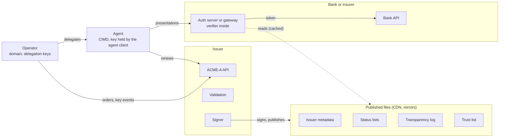

# Veridact: open specification for AI agent credentials

Version 0.5 (draft) · 22 November 2026 · [Changes from v0.4](#appendix-a-changes-from-v04) · [Open questions](#appendix-b-open-questions)

> **Status: draft.** v0.5 replaces v0.4. The reference packages (`verify`, `issuer`, `vbot`, the sidecar, the sandbox, the integrations and the known-assistant attester) implement v0.5; the repository README says what each one covers. The staging network is alpha and was reset at the switch.

## 1. Introduction

Veridact issues short-lived credentials to AI agents through an ACME-style protocol, so banks, insurers and other APIs can verify which organisation operates an agent, and what it may do. This document is the open part of Veridact: the credential formats, identifiers, issuance protocol and verification rules that anyone can implement. Running an issuer is a separate, accredited service.

Every artefact in this specification is a JWT that a bank's authorisation server, API gateway and HSM already handle, and every key is published at an HTTPS URL. A relying party needs no DID resolver, no JSON-LD processor and no wallet.

| Decision | Choice | Reason |
|---|---|---|
| Credential format | SD-JWT VC, ES256 | A JWT every OAuth stack can verify, with selective disclosure. The format the IETF OAuth working group and the EU digital identity wallet use |
| Identifiers | HTTPS URLs. An agent's identifier is its Client ID Metadata Document URL | The agent's OAuth `client_id` and its Veridact identity are the same string |
| Revocation | Token Status List | Compact, cacheable, herd-private, and defined for JWT credentials |
| Issuance protocol | ACME (RFC 8555) profile, "ACME-A" | A proven automation model with mature client tooling |
| Key history | Key events in a public transparency log | Anyone can audit every key an operator or agent has used |

### 1.1 Audience and scope

**Audience:** relying parties (banks, insurers and other APIs), agent operators, and anyone implementing an issuer or a verifier.

**In scope:** identifying the organisation that operates an agent, the agent itself, the authority the organisation delegated to it, and mainstream AI assistants that connect to relying parties as OAuth clients.

**Out of scope:** identifying or enrolling natural persons, and payment authorisation. What a bank customer allowed stays with that bank's own authorisation server. [Veridact Valet](https://github.com/veridactlabs/veridact-valet) is one way a bank can hold and enforce that consent.

### 1.2 Standards used

Veridact builds only on published standards and IETF working group drafts:

- SD-JWT ([RFC 9901](https://www.rfc-editor.org/rfc/rfc9901)) and SD-JWT VC (draft-ietf-oauth-sd-jwt-vc)
- Token Status List (draft-ietf-oauth-status-list)
- OAuth Client ID Metadata Documents (draft-ietf-oauth-client-id-metadata-document)
- OAuth attestation-based client authentication (draft-ietf-oauth-attestation-based-client-auth)
- ACME ([RFC 8555](https://www.rfc-editor.org/rfc/rfc8555)) and ACME Renewal Information ([RFC 9773](https://www.rfc-editor.org/rfc/rfc9773))
- OAuth token exchange ([RFC 8693](https://www.rfc-editor.org/rfc/rfc8693)), DPoP ([RFC 9449](https://www.rfc-editor.org/rfc/rfc9449)), mutual-TLS client authentication and certificate-bound tokens ([RFC 8705](https://www.rfc-editor.org/rfc/rfc8705))
- JWK Thumbprint ([RFC 7638](https://www.rfc-editor.org/rfc/rfc7638)) and JWK Thumbprint URI ([RFC 9278](https://www.rfc-editor.org/rfc/rfc9278))
- Certificate Transparency v2 ([RFC 9162](https://www.rfc-editor.org/rfc/rfc9162)), X.509 ([RFC 5280](https://www.rfc-editor.org/rfc/rfc5280)), time-stamping ([RFC 3161](https://www.rfc-editor.org/rfc/rfc3161)) and evidence records ([RFC 4998](https://www.rfc-editor.org/rfc/rfc4998))

### 1.3 Conventions

The key words MUST, MUST NOT, REQUIRED, SHALL, SHALL NOT, SHOULD, SHOULD NOT, RECOMMENDED, NOT RECOMMENDED, MAY and OPTIONAL in this document are to be interpreted as described in BCP 14 ([RFC 2119](https://www.rfc-editor.org/rfc/rfc2119), [RFC 8174](https://www.rfc-editor.org/rfc/rfc8174)) when, and only when, they appear in all capitals.

All signatures in this specification are ES256 (ECDSA with P-256 and SHA-256). A verifier MUST refuse any other `alg` before doing anything else with a token. Amounts are decimal strings, such as `"500.00"`, so no implementation loses cents to binary floating point. Times in JWT claims are NumericDate values. Claim names use snake_case.

Examples are illustrative. An ellipsis (`…`) marks a value shortened for reading.

## 2. Terms

| Term | Meaning |
|---|---|
| Operator | The organisation that runs agents and answers for them, identified by a domain it controls |
| Agent | Software that acts for an operator and holds its own non-exportable key |
| Agent class, agent instance | An agent class is durable and has an identifier. An instance is temporary and acts under a grant (see [§8](#8-sub-agents)) |
| Sub-agent | An agent instance that an agent hands work to, under a Sub-agent Grant |
| Issuer | A service that validates operators and issues Veridact credentials. Veridact runs one; members may run others |
| Relying party | An API, usually a bank or an insurer, that decides whether to serve an agent |
| Governance authority | The member consortium that accredits issuers and sets policy through the trust list |
| Approver | A person the operator appoints, by role, to delegate authority to agents |
| Known assistant | A mainstream AI assistant platform, such as Claude or ChatGPT, that connects to relying parties as one OAuth client and does not run ACME-A |
| Tier | The level of validation behind a credential: Domain or Organisation |
| Agent URL | An agent's identifier: the HTTPS URL of its Client ID Metadata Document |
| CIMD | Client ID Metadata Document: a JSON document at an HTTPS URL that describes an OAuth client, whose `client_id` is that URL |
| Trust list | The governance-signed list of accredited issuers, their keys and the policy parameters every component reads |
| Transparency log | The public, append-only log of every credential issued and every key event |
| Key event | A transparency log entry that adds, retires or marks as compromised an operator or agent key |
| Presentation | An SD-JWT+KB: an Agent Credential, the disclosures a relying party asks for, and a Key Binding JWT |
| Verification Record | The self-contained evidence a relying party keeps for a decision (see [§16](#16-archival-verification)) |

## 3. Architecture

Veridact has three planes, and relying parties never call an issuer's APIs to verify an agent. They read only public, cacheable artefacts, so verification keeps working through an issuance outage, and no issuer can see where agents are used.



The dashed line is the only link between relying parties and Veridact: cached reads of public files. Agents talk to an issuer to get credentials, and to relying parties to use them.

| Component | Plane | Responsibility |
|---|---|---|
| ACME-A API | Issuance | Accounts, orders, challenges, key events, credential download, renewal |
| Validation workers | Issuance | Domain, operator-key and client-metadata checks, from several network vantage points |
| Signer | Issuance | The only component that can use issuer keys; signs credentials and status lists |
| Metadata host | Publication | Serves JWT VC Issuer Metadata, and CIMDs for Veridact-hosted agents |
| Status service | Publication | Builds and signs Token Status Lists for revocation and suspension |
| Transparency log | Publication | Append-only, publicly auditable record of every credential and key event |
| Trust registry | Publication | Signed list of accredited issuers, tiers, keys and policy parameters |
| Verifier library and sidecar | Verification | Runs inside each relying party; verifies presentations with no call home |
| Agent client (vbot) | Agent side | Holds the agent key, publishes its CIMD, runs ACME-A orders, renews and fails over between issuers, builds presentations |

## 4. Trust model

A relying party trusts an agent because a chain of signatures leads from the agent's key to an issuer that the trust list accredits for the required tier. Issuers vouch for organisations and the software they operate. They never vouch for natural persons.

| Actor | Role | Trusts |
|---|---|---|
| Operator | Organisation that runs agents and answers for them | The issuer to validate it fairly |
| Agent | Software acting for the operator, holding its own key | Its operator's delegation |
| Issuer | Validates operators, issues Operator, Agent and Known-Assistant Credentials | Governance policy and its own validation evidence |
| Relying party | API that decides whether to serve an agent | Issuers listed in the signed trust list |
| Governance authority | Member consortium that accredits issuers and sets policy | Its members and auditors |
| Monitor | Anyone watching the transparency log, usually operators | The log's signed tree heads |

The chain a relying party checks, from the request inwards:

1. The Key Binding JWT is signed by the key the Agent Credential's `cnf` names.
2. The Agent Credential binds that key to the agent URL, carries the operator facts the issuer validated, and is signed by an issuer key.
3. The trust list names that issuer and key, and accredits the issuer for the credential's type and tier.
4. Neither the agent's status entry nor its operator's is set.

| Tier | What it proves | Validation | Agent Credential lifetime |
|---|---|---|---|
| Domain | The agent is operated by whoever controls this domain | Automated `dns-01` and `operator-keys-01` challenges | Default 8 hours, maximum 24 hours |
| Organisation | The agent acts for a specific, legally registered organisation, under a named accountable role | Domain tier, plus a CIPC registration or vLEI check and review; re-validated every 12 months | Default 8 hours, maximum 24 hours |

The governance authority MAY define further tiers.

When an agent acts for a bank customer, two separate authorities apply. Veridact says which software is calling and who answers for it. The bank's own authorisation server says what that customer allowed, and issues tokens bound to the agent's key (see [§10.4](#104-access-tokens)).

## 5. Identifiers and keys

Every issuer, operator and agent is identified by an HTTPS URL. Keys are published as JWK Sets at well-known locations under that URL. An identifier is compared as a plain string, with no normalisation.

| Party | Identifier | Keys published at |
|---|---|---|
| Issuer | `https://veridact.net/issuers/{tier}-{epoch}` | JWT VC Issuer Metadata at `https://veridact.net/.well-known/jwt-vc-issuer/issuers/{tier}-{epoch}`. The trust list pins the same keys |
| Operator | `https://{domain}`, a domain the issuer validated | `https://{domain}/.well-known/veridact-operator.json` |
| Agent, operator-hosted | `https://{domain}/agents/{agent id}` | The CIMD at that URL (`jwks`) |
| Agent, Veridact-hosted | `https://agents.veridact.net/{account slug}/{agent id}` | The CIMD at that URL, served by the issuer |
| Known assistant | The platform's own CIMD URL, or a stable name (see [§13](#13-known-assistants)) | Not applicable: known assistants hold no Veridact key |

Agent ids and account slugs MUST be opaque random strings of at least 64 bits of entropy, because metadata documents and the transparency log are public, and descriptive names can leak business information.

These patterns are normative for issuers. An issuer MUST accept an agent URL only under one of the ordering operator's validated domains, at the `/agents/` path, or under the ordering account's own slug on the issuer's agent hosting. A domain cannot vouch for an agent hosted elsewhere.

### 5.1 Agents are OAuth clients

An agent's identifier is the URL of its Client ID Metadata Document. The document follows draft-ietf-oauth-client-id-metadata-document, and:

- `client_id` MUST equal the URL;
- `jwks` MUST hold the agent's authentication keys, and MUST NOT be replaced by `jwks_uri`;
- `token_endpoint_auth_methods_supported` MUST include the attestation-based method used in pattern C ([§10.3](#103-pattern-c-client-attestation)), and MAY include `private_key_jwt`.

```json title="Agent CIMD, served at https://operator.example/agents/a7f3k2"
{
  "client_id": "https://operator.example/agents/a7f3k2",
  "client_name": "Claims assistant",
  "jwks": { "keys": [{ "kty": "EC", "crv": "P-256", "x": "…", "y": "…", "kid": "Ab3…", "use": "sig" }] },
  "token_endpoint_auth_methods_supported": ["attest_jwt_client_auth_dpop", "private_key_jwt"],
  "grant_types": ["urn:ietf:params:oauth:grant-type:token-exchange", "client_credentials"]
}
```

Each key's `kid` MUST be its JWK Thumbprint (RFC 7638). The same URL is the `sub` of the Agent Credential and the `client_id` at every relying party, so OAuth client identification and Veridact verification name the agent the same way.

### 5.2 Operators

An operator is identified by its validated domain, as `https://{domain}`. The domain serves an operator metadata document:

```json title="https://operator.example/.well-known/veridact-operator.json"
{
  "operator": "https://operator.example",
  "jwks": { "keys": [{ "kty": "EC", "crv": "P-256", "x": "…", "y": "…", "kid": "Pq7…", "use": "sig" }] },
  "agents": ["https://operator.example/agents/"]
}
```

- `operator` MUST equal the operator identifier.
- `jwks` holds the operator's delegation-signing keys. Each `kid` MUST be the key's JWK Thumbprint.
- `agents` is OPTIONAL: the agent URL prefixes the operator runs.

### 5.3 Key events

Every operator and agent key change is recorded in the transparency log before it takes effect. A key event entry records:

| Field | Meaning |
|---|---|
| `subject` | The operator or agent URL |
| `jkt` | The key's JWK Thumbprint |
| `action` | `add`, `retire` or `compromise` |
| `time` | When the action takes effect. For `compromise`, the earliest time the key may have been exposed |
| `account_sig` | A JWS over the other fields by the operator's ACME-A account key |

Issuers append key events when an operator adds or retires a key through ACME-A ([§9.5](#95-key-events)). An issuer MUST NOT issue a credential bound to a key that has no `add` event, or that has a `retire` or `compromise` event. It records the `add` event's log entry id in the Agent Credential as `cnf_event`. When a `retire` or `compromise` event is logged, the issuer MUST revoke every live credential bound to that key within 5 minutes.

So a thief who edits a CIMD or an operator metadata document still cannot get a new key accepted without an ACME-A request from the operator's account, and that request is logged and monitored. Monitors alert the operator within minutes of any key event in its name.

### 5.4 Keys

| Key | Algorithm | Custody | Rotation |
|---|---|---|---|
| Issuer credential signing | ES256 (P-256) | HSM-backed, non-exportable, usable only by the signer | Every 90 days, with a 30-day overlap in the trust list |
| Issuer Agent CA | ES256 (P-256) | HSM-backed, non-exportable, usable only by the signer | Every 90 days, with a 30-day overlap in the trust list |
| Operator delegation key | ES256 (P-256) | The operator's KMS or HSM. Non-exportable at Organisation tier | At least yearly, through key events |
| Agent key | ES256 (P-256) | Non-exportable: cloud KMS, TPM or HSM. Software keys are allowed at Domain tier only | At most every 30 days, or on redeploy, through key events |
| Agent TLS key (optional) | ES256 (P-256) | As the agent key; MAY be the agent key itself (see [§15](#15-agent-certificates)) | As the agent key |
| Approver key | ES256 (P-256) | Passkey-backed, held by the approver | With the approver's passkey |
| Sub-agent key | ES256 (P-256) | Held by the sub-agent; never published | Per sub-agent; discarded when its grant expires |
| ACME-A account key | ES256 | The operator's secret store | On compromise or staff change |

Issuer keys have no key events. The governance-signed trust list is the only source of issuer keys, and it already has witnesses, epochs and an overlap period ([§17](#17-trust-registry-and-governance)).

## 6. Credentials

### 6.1 Common rules

Every Veridact credential is an SD-JWT VC (draft-ietf-oauth-sd-jwt-vc):

- The issuer-signed JWT has `typ` `dc+sd-jwt` and `alg` `ES256`.
- `kid` names an issuer key that is listed both in the trust list and in the issuer's JWT VC Issuer Metadata. An issuer MAY also include an `x5c` chain, for relying parties that pin X.509 anchors.
- `iss`, `vct`, `jti`, `sub`, `iat`, `nbf` and `exp` are REQUIRED. `nbf` MUST equal `iat`, so ordinary gateways can enforce the validity window.
- `status` carries a Token Status List reference ([§14.1](#141-token-status-list)).
- `_sd_alg` is `sha-256`.

Claims marked (SD) below are selectively disclosable: the issuer MUST issue them as disclosures, and the agent discloses them only to relying parties whose route requires them ([§10.1](#101-the-presentation)). All other claims MUST be plain claims.

| Credential | `vct` | Issued by | `sub` | Lifetime |
|---|---|---|---|---|
| Operator Credential | `https://veridact.net/vct/operator/v1` | Issuer | Operator URL | 90 days at Domain tier, 12 months at Organisation tier |
| Approver Credential | `https://veridact.net/vct/approver/v1` | Operator | Pseudonymous approver id | Set by the operator; at most 12 months |
| Delegation Credential | `https://veridact.net/vct/delegation/v1` | Operator, with approver signatures | Agent URL | Up to 90 days |
| Agent Credential | `https://veridact.net/vct/agent/v1` | Issuer | Agent URL | Default 8 hours, maximum 24 hours |
| Known-Assistant Credential | `https://veridact.net/vct/known-assistant/v1` | Issuer | Platform identifier | Up to 90 days |

### 6.2 Operator Credential

Issued once an operator completes onboarding ([§9.3](#93-operator-onboarding)).

| Claim | Meaning |
|---|---|
| `tier` | `domain` or `organisation` |
| `domains` | The domains the issuer validated |
| `log_entry` | The credential's own transparency log entry id |
| `cnf` | `{ "jwk": … }`: the operator delegation key proven at onboarding |
| `status` | Its status entry, on an operator status list |
| `legal_name` (SD) | The registered legal name. Organisation tier only |
| `registration` (SD) | CIPC registration number or LEI. Organisation tier only |
| `jurisdiction` (SD) | ISO 3166-1 alpha-2 country code. Organisation tier only |

### 6.3 Approver Credential

An admin, signed in to the operator's own identity system with a passkey, appoints each approver. The issuer never sees a name.

| Claim | Meaning |
|---|---|
| `role` | A role title, such as "Head of Digital Claims". Never a person's name |
| `scopes` | The scopes this approver may delegate |
| `ceiling` | `{ "currency", "per_payment", "per_day" }`: the most this approver may delegate |
| `cnf` | `{ "jwk": … }`: the approver's passkey-backed key |

The Approver Credential is signed by an operator delegation key, with `iss` the operator URL.

### 6.4 Delegation Credential

An approver delegates to an agent by choosing a purpose, scopes, limits and a lifetime, reading a plain-language summary, and signing it with their passkey ([§7](#7-delegation-and-human-intent)). The operator then issues the Delegation Credential, signed with an operator delegation key:

```json title="Delegation Credential, issuer-signed part"
{
  "iss": "https://operator.example",
  "vct": "https://veridact.net/vct/delegation/v1",
  "jti": "urn:uuid:2b7e…",
  "sub": "https://operator.example/agents/a7f3k2",
  "iat": 1792396800, "nbf": 1792396800, "exp": 1800172800,
  "scopes": ["fs:claims:read-status"],
  "limits": { "currency": "ZAR", "per_payment": "500.00", "per_day": "2000.00" },
  "accountable_role": "Head of Digital Claims",
  "max_lifetime": 28800,
  "environment": "staging",
  "audiences": ["https://api.bank.example"],
  "certificate_max_lifetime": 900,
  "approvals": [{ "approver": "<Approver Credential>", "sig": "<JWS by the approver's cnf key over the terms digest>" }]
}
```

- `environment` MUST match the issuer's, so a staging delegation cannot obtain production credentials.
- `audiences` and `certificate_max_lifetime` are OPTIONAL.
- `approvals` carries one entry per approver. The terms digest is the base64url SHA-256 of the JCS-canonical ([RFC 8785](https://www.rfc-editor.org/rfc/rfc8785)) object of `sub`, `scopes`, `limits`, `accountable_role`, `max_lifetime`, `environment`, `audiences` and `exp`.
- A delegation whose `per_payment` exceeds the issuer's two-person threshold (R1,000 for ZAR) MUST carry two approvals from different approvers.

The Delegation Credential is never presented to a relying party. Its terms reach relying parties only through the Agent Credential the issuer derives from it.

### 6.5 Agent Credential

The Agent Credential carries everything a relying party needs about the agent and its operator, copied and signed by the issuer at issuance. A presentation therefore carries only this one credential.

| Claim | Meaning |
|---|---|
| `operator` | The operator URL |
| `operator_credential` | The `jti` of the Operator Credential |
| `operator_status` | The Operator Credential's status reference, so revoking the operator stops all its agents |
| `tier` | No higher than the Operator Credential's tier |
| `scopes` | Capped by tier policy and by the delegation |
| `limits` | Per-payment and daily limits from the delegation, capped by each approver's ceiling |
| `accountable_role` | From the delegation |
| `cnf` | `{ "jwk": … }`: the agent key |
| `cnf_event` | The transparency log entry id of the `add` key event for the `cnf` key |
| `status` | Its status entry, on an agent status list |
| `operator_legal_name` (SD) | Copied from the Operator Credential |
| `operator_registration` (SD) | Copied from the Operator Credential |
| `operator_jurisdiction` (SD) | Copied from the Operator Credential |

```json title="Agent Credential, issuer-signed part (disclosures omitted)"
{ "alg": "ES256", "typ": "dc+sd-jwt", "kid": "org-2026b-3" }
.
{
  "iss": "https://veridact.net/issuers/org-2026b",
  "vct": "https://veridact.net/vct/agent/v1",
  "jti": "urn:uuid:5f0c2d6e-8b1a-4c3e-9f27-1d4a6b8e0c55",
  "sub": "https://operator.example/agents/a7f3k2",
  "iat": 1792483200, "nbf": 1792483200, "exp": 1792512000,
  "operator": "https://operator.example",
  "operator_credential": "urn:uuid:9d2e7a10-3c44-4b8f-a6e1-0f5b2c7d9e31",
  "operator_status": { "status_list": { "idx": 9123, "uri": "https://status.veridact.net/org/operators/2" } },
  "tier": "organisation",
  "scopes": ["fs:claims:read-status", "fs:quotes:create"],
  "accountable_role": "Head of Digital Claims",
  "limits": { "currency": "ZAR", "per_payment": "500.00", "per_day": "2000.00" },
  "cnf": { "jwk": { "kty": "EC", "crv": "P-256", "x": "…", "y": "…" } },
  "cnf_event": "veridact-log-2026/000000456",
  "status": { "status_list": { "idx": 48213, "uri": "https://status.veridact.net/org/agents/7" } },
  "_sd": ["…", "…", "…"], "_sd_alg": "sha-256"
}
```

**Scopes** come from a shared taxonomy that the governance authority owns, namespaced by sector (`fs:` for financial services). A relying party MUST grant no more than the intersection of the credential's scopes and its own policy. A verifier MUST drop scopes that are not in the trust list's taxonomy, rather than treat them as an error.

**Limits.** An Agent Credential with no `limits`, or none in a payment's currency, gives the agent no authority to pay without a person.

**Status.** Revoking either the Agent Credential or its Operator Credential MUST take effect in the published status list within 5 minutes.

## 7. Delegation and human intent

An agent's authority flows down a chain of signatures, and nobody in the chain can give away more than they hold. People sit at the points that carry accountability. Everything that can be checked mechanically runs without them.

1. **The organisation appoints approvers.** An admin issues each approver an Approver Credential: a role title, a pseudonymous approver id, the scopes they may delegate and their own ceiling, for example R500 a payment.
2. **An approver delegates to an agent.** They choose purpose, scopes, a per-payment limit, a daily limit and a lifetime of at most 90 days, read a plain-language summary, and sign it with their passkey. Single payments above R1,000 need a second, different approver.
3. **The issuer checks the chain** before it issues an Agent Credential: each Approver Credential is signed by a key in the operator's metadata, each approver signed these exact terms, the scopes and limits are within each approver's own authority, and the two-person rule is met. It copies the scopes and limits into the Agent Credential.
4. **The agent acts alone inside the limits.** Relying parties enforce the per-payment and daily limits from the Agent Credential. The verifier keeps no ledger: the relying party supplies what it has already let the agent pay that day.
5. **Outside the limits, a person decides.** The relying party returns `ask_person` with an intent request: the exact action, why it was stopped, and the agent's own note. It is routed to the lowest-ranked approver with enough authority. Their approval MUST be signed over a hash of that exact action, MUST be single-use, and MUST expire after 5 minutes.

Until an issuer accepts Approver Credentials, it MUST refuse any delegation whose `per_payment` exceeds R1,000, rather than skip the second approver.

## 8. Sub-agents

An agent class is durable and has an agent URL. An agent instance is temporary and gets a grant. When an agent hands work to a sub-agent, it signs a Sub-agent Grant that narrows its own authority. The sub-agent never gets an agent URL or an Agent Credential, never shares its parent's key, and every hop can only take authority away. The chain verifies offline, with no call to the issuer.

**The grant** is a compact JWS, ES256, `typ` `veridact-subgrant+jwt`. The first grant is signed by the key the Agent Credential's `cnf` names, and each later one by the key in the previous grant's `cnf`.

```json title="Sub-agent Grant payload"
{
  "iss": "https://operator.example/agents/a7f3k2",
  "cred": "<Agent Credential jti, first grant only>",
  "prev": "<base64url SHA-256 of the previous grant's compact JWS, later grants only>",
  "jti": "<uuid>",
  "cnf": { "jwk": { "kty": "EC", "crv": "P-256", "x": "…", "y": "…" } },
  "scopes": ["fs:claims:read-status"],
  "limits": { "currency": "ZAR", "per_payment": "200.00", "per_day": "500.00" },
  "audiences": ["https://api.bank.example"],
  "iat": 1795075200,
  "exp": 1795076100
}
```

`iss` is the root agent URL on every grant. The sub-agent signs the presentation's Key Binding JWT with its own key, and carries the grants root-first in the KB-JWT's `veridact_grants` claim ([§10.1](#101-the-presentation)).

**Grant rules.** A verifier applies these in checks 3 and 6 ([§11](#11-verification)). Every failure returns `AUTH_FAILED`. The logged reason goes only to the relying party's logs.

| Rule | Logged reason |
|---|---|
| The first grant is signed by the Agent Credential's `cnf` key, names the credential in `cred`, and has no `prev` | `GRANT_SIGNATURE` |
| Each later grant is signed by the previous grant's `cnf` key, and its `prev` matches the previous grant | `GRANT_SIGNATURE` |
| `iss` is the agent URL on every grant | `GRANT_SIGNATURE` |
| `scopes` are a subset of the parent's. The first grant's parent is the credential's scopes after trust list filtering | `GRANT_WIDENS_SCOPE` |
| Per currency, `per_payment` and `per_day` are at most the parent's, and no grant adds a currency its parent lacks | `GRANT_WIDENS_LIMIT` |
| `audiences` are a subset of the parent's and include this relying party | `GRANT_WIDENS_AUDIENCE` |
| `exp` is no later than the parent grant's or the Agent Credential's, and `exp − iat` ≤ `subAgentGrantMaxLifetime` | `GRANT_EXPIRED` |
| The chain is no longer than `maxSubAgentDepth` | `GRANT_TOO_DEEP` |
| The KB-JWT is signed by the last grant's `cnf` key | `GRANT_SIGNATURE` |

Unknown scopes in a credential are dropped, but a grant that tries to widen MUST be rejected outright: it is either broken or hostile. The trust list sets `maxSubAgentDepth` (default 2; 0 disables sub-agents) and `subAgentGrantMaxLifetime` (default 900 seconds).

**Limits.** The root agent's `per_day` is a budget shared by the whole family: the relying party counts payments by any sub-agent against the agent URL. The last grant's `per_day` is a budget of its own, tracked by the last grant's key thumbprint. An intermediate grant's `per_day` only caps what its children may be given, so siblings together may spend more than their parent's daily limit, but never more than the root's. The verifier takes both paid-today figures and reports the agent URL and the last key thumbprint.

**Revocation and audit.** Grants have no status entry. They end by expiry, or when the Agent Credential is revoked, which ends the whole family at once. Grants never pass through the issuer or the transparency log, so relying parties MUST log the SHA-256 of the grant chain alongside the agent URL. The operator can then trace from its own records which sub-agent acted.

> **Note.** RFC 9901 expects a KB-JWT to be signed by the credential's `cnf` key. A sub-agent's KB-JWT is signed by its grant key instead, so a generic SD-JWT verifier rejects it, which fails closed. Veridact tracks draft-ietf-oauth-delegate-sd-jwt and expects to adopt it for sub-agents once it stabilises.

## 9. Issuance protocol (ACME-A)

ACME-A is a profile of ACME ([RFC 8555](https://www.rfc-editor.org/rfc/rfc8555)). It keeps ACME's accounts, orders, authorisations, JWS-signed requests and nonces, and adds one identifier type, three challenge types, key events and a credential download in place of a certificate. Existing ACME client libraries can be extended rather than rewritten.

### 9.1 Resources

| Method and path | Purpose | Change from RFC 8555 |
|---|---|---|
| `GET /directory` | Endpoint discovery, terms of service, tiers offered | Adds `veridactAgentMetadata` and `veridactKeyEvent`, and in `meta` `veridactSpecification`, `veridactTiers`, `veridactEnvironment`, `veridactIssuer`, `veridactAgentHosting`, `veridactScopes`, `veridactFormats` and `trustList` |
| `HEAD /new-nonce` | Anti-replay nonce for every POST | None |
| `POST /new-account` | Register the operator's account key | Adds optional `externalAccountBinding` for Organisation tier contracts |
| `POST /new-order` | Request a credential for one identifier | New identifier type `agent`; `dns` used for operators |
| `POST /authz/{id}` | Fetch an authorisation and its challenges | None |
| `POST /chall/{id}` | Tell the issuer a challenge is ready | New challenge types below |
| `POST /order/{id}/finalize` | Submit the key-binding proof and request issuance | A key-binding JWT replaces the CSR |
| `POST /cred/{id}` | Download the issued credential | Returns `application/dc+sd-jwt`, with the transparency log receipt in a `Veridact-Log-Receipt` header |
| `POST /revoke-cred` | Revoke a credential | Sets its status list entry instead of updating a CRL |
| `GET /renewal-info/{id}` | Suggested renewal window | ARI ([RFC 9773](https://www.rfc-editor.org/rfc/rfc9773)), keyed by the credential's `jti` |
| `POST {veridactKeyEvent}` | Add, retire or mark compromised an operator or agent key | New ([§9.5](#95-key-events)) |
| `POST {veridactAgentMetadata}/{agent id}` | Upload a Veridact-hosted agent's CIMD, served under `veridactAgentHosting` | New |

### 9.2 Challenges

| Challenge | Proves | How it is checked |
|---|---|---|
| `dns-01` | Control of the operator's domain | Standard: a TXT record at `_acme-challenge.{domain}` holding the key-authorisation digest |
| `operator-keys-01` (new) | The operator's delegation key belongs to the domain | The issuer fetches `https://{domain}/.well-known/veridact-operator.json` and checks that `operator` is `https://{domain}` and that `jwks` lists the key in the order's key-binding JWT |
| `client-metadata-01` (new) | The agent URL serves this agent's key | The issuer fetches the agent URL and checks that it is a CIMD whose `client_id` equals the URL and whose `jwks` contains the key in the key-binding JWT |
| `delegation-01` (new) | The operator authorised this agent | The client POSTs `{"delegation": "<Delegation Credential>"}`. The issuer checks it as in [§7](#7-delegation-and-human-intent), against an operator holding a valid Operator Credential, with scopes inside the tier's policy |

Challenges validate synchronously when the client responds, and a failed challenge invalidates the order, as in RFC 8555.

The issuer MUST run `dns-01`, `operator-keys-01` and `client-metadata-01` from at least three network vantage points, and all MUST agree, so a local DNS or routing hijack cannot mint a credential. An optional `_veridact.{domain}` TXT record pins which ACME-A accounts may order for the domain, much as a CAA record does for certificates.

### 9.3 Operator onboarding

Done once, and renewed every 90 days or 12 months:

1. The operator registers an account key with `new-account`.
2. It publishes its operator metadata document and logs an `add` key event for its delegation key.
3. It orders a `dns` identifier for its domain and completes `dns-01` and `operator-keys-01`.
4. At Organisation tier, a reviewer matches the CIPC registration or vLEI to the domain owner before issuance.
5. The issuer issues the Operator Credential and logs it.

### 9.4 Agent issuance

Automated, and repeated every few hours:

1. The agent client generates the agent key in KMS, TPM or HSM, publishes the agent's CIMD, and logs an `add` key event for the key.
2. It orders an `agent` identifier whose value is the agent URL, completes `client-metadata-01`, and submits the Delegation Credential to `delegation-01`.
3. At finalize it sends a key-binding JWT signed by the agent key.
4. The issuer checks the delegation, the operator's credential status, tier policy, the key's key events and the proof of possession, then signs the Agent Credential.
5. The credential is appended to the transparency log before it is released, and the download carries the log receipt.
6. The client renews in the window that `renewal-info` suggests, by default two thirds of the way through the lifetime.

Rate limits apply per account and per operator domain, so a compromised account cannot flood the log.

### 9.5 Key events

The account POSTs, ACME-signed:

```json title="POST /key-event"
{ "subject": "https://operator.example/agents/a7f3k2", "jwk": { "kty": "EC", "crv": "P-256", "x": "…", "y": "…" }, "action": "add" }
```

The issuer MUST accept a key event only for an operator URL whose Operator Credential the account holds, or for an agent URL that account may order for ([§5](#5-identifiers-and-keys)). It appends the event to the transparency log and returns the log receipt. For `add`, the key takes effect once the event is logged. For `retire` and `compromise`, the issuer revokes credentials as [§5.3](#53-key-events) requires. A `compromise` event MAY carry a `time` earlier than the request.

### 9.6 Wire formats

**Key-binding JWT.** The finalize request carries `{"keyBinding": "<compact JWS>"}`: ES256, `typ` `veridact-kb+jwt`, with `kid` the key's JWK Thumbprint. Payload:

```json title="Key-binding JWT payload"
{ "iss": "<subject URL>", "aud": "<this order's finalize URL>", "nonce": "<the ACME nonce of this finalize request>", "iat": 1794981300 }
```

The nonce is the one in the outer JWS's protected header, so the proof cannot be replayed into another request, and `iat` MUST be within 5 minutes. For an Agent Credential the key MUST be in the agent's CIMD and becomes `cnf`. For an Operator Credential it MUST be in the operator metadata document and becomes the Operator Credential's `cnf`.

**Who may order for an agent.** The account placing an agent order MUST hold a valid Operator Credential for the delegation's issuer. Otherwise whoever holds an agent key and a copy of its delegation, a compromised agent host for example, could keep renewing from an account of their own, out of the operator's sight.

**Orders, tiers and lifetimes.** An order carries one identifier. `new-order` takes an optional `tier` (default: the issuer's lowest), an optional `lifetime` in seconds, and optional `formats`: `dc+sd-jwt` (the default), `client-attestation` ([§10.3](#103-pattern-c-client-attestation)) and `x509` ([§15](#15-agent-certificates)), with an optional `certificateLifetime`. An Agent Credential's lifetime is the smallest of the request (default 8 hours), the delegation's `max_lifetime`, the trust list's maximum, and the time left on the delegation and on the Operator Credential. If that is under 5 minutes, the issuer MUST refuse.

**Veridact-hosted agents.** The account POSTs `{"metadata": <document>}`, ACME-signed, to `{veridactAgentMetadata}/{agent id}`, and the issuer serves it under `{veridactAgentHosting}/{account slug}/{agent id}`. The issuer MUST serve only documents whose `client_id` is that URL, under the account's own slug, and whose keys all have a logged `add` event.

**Transparency log receipt.** The receipt travels in the `Veridact-Log-Receipt` response header as base64url JSON, and holds an inclusion proof. Log entry ids, including the one an Operator Credential carries, are `{log id}/{index, 9 digits}`. An Operator Credential names its entry before it is signed, so the issuer serialises issuance and signs the next index in.

## 10. Presenting to a relying party

### 10.1 The presentation

A presentation is an SD-JWT with Key Binding (RFC 9901): the Agent Credential, the disclosures the relying party asks for, and a Key Binding JWT.

```text title="Presentation, serialised"
<Agent Credential>~<disclosure>~<disclosure>~<KB-JWT>
```

```json title="KB-JWT, decoded"
{ "alg": "ES256", "typ": "kb+jwt" }
.
{ "aud": "https://api.bank.example", "nonce": "9f2c41d0a7e3b5f8", "iat": 1792483500, "sd_hash": "…" }
```

- The KB-JWT MUST be signed by the Agent Credential's `cnf` key or, for a sub-agent, by the last grant's `cnf` key, with the grants root-first in `veridact_grants`.
- A relying party MUST accept a KB-JWT only within 120 seconds of its `iat`, plus its configured clock skew.
- Each route at a relying party says which (SD) claims it needs, for example `operator_legal_name` for a consent screen. The agent SHOULD disclose only those.

### 10.2 Patterns A and B

The RECOMMENDED integration is a token exchange at the relying party's existing authorisation server: the agent trades one verified presentation for a short-lived, key-bound access token, so downstream APIs see only the JWTs they already accept. Direct verification at the API gateway suits relying parties without an authorisation server in the agent path. Pattern C ([§10.3](#103-pattern-c-client-attestation)) suits authorisation servers that support attestation-based client authentication.

| Pattern | How it works | Fits |
|---|---|---|
| A. Token exchange (recommended) | The agent sends its presentation as the `subject_token` of an OAuth token exchange. The authorisation server verifies it through the Veridact verifier and issues a DPoP-bound or certificate-bound access token | Banks with Keycloak, PingFederate, Entra or similar in front of their APIs |
| B. Gateway verification | The API returns 401 with a nonce. The agent retries with `Authorization: Veridact sd-jwt="<presentation>"`, and a gateway authoriser verifies it | AWS API Gateway (Lambda authoriser), Kong or Envoy without an authorisation server |
| C. Client attestation | The agent authenticates to the authorisation server with a Veridact Client Attestation | Authorisation servers that support draft-ietf-oauth-attestation-based-client-auth |

**Pattern B.** The challenge:

```http title="Response: relying party → agent"
HTTP/1.1 401 Unauthorized
WWW-Authenticate: Veridact realm="claims-api", nonce="9f2c41d0a7e3b5f8", tier="organisation", scope="fs:claims:read-status", claims="operator_legal_name"
```

`claims` is OPTIONAL: the (SD) claims the route requires. The KB-JWT's `aud` MUST be the origin of the request URL. The challenge does not carry `aud`, so a man-in-the-middle cannot choose it.

**Pattern A.** Token exchange has no challenge step, so the nonce comes from the token endpoint itself, as DPoP servers hand out nonces (RFC 9449 section 8). A request with no `subject_token`, or with a spent or unknown nonce, gets `400 {"error": "use_veridact_nonce"}` and a `Veridact-Nonce` response header. The agent builds a presentation for that nonce, with `aud` set to the token endpoint's origin, and retries with:

- `subject_token`: the presentation;
- `subject_token_type`: `urn:veridact:params:oauth:token-type:sd-jwt-kb`;
- a proof of the binding key. With DPoP, a DPoP proof made with the KB-JWT's signing key. With mutual TLS, an Agent Certificate whose SAN equals the Agent Credential's `sub`, and the token is certificate-bound (`cnf.x5t#S256`, RFC 8705).

### 10.3 Pattern C: client attestation

When an order's `formats` includes `client-attestation`, the issuer also signs a Client Attestation: a JWT with `typ` `oauth-client-attestation+jwt`, with the same `sub` (the agent URL), `iat`, `exp`, `cnf.jwk` and `status` as the Agent Credential, and a `veridact` claim holding `operator`, `tier`, `scopes`, `limits`, `operator_status` and the Agent Credential's `jti`.

The Client Attestation has no selective disclosure: it carries only what an authorisation server needs to admit the client. It is logged with the Agent Credential, and revoking either MUST revoke both.

The agent sends it in the `OAuth-Client-Attestation` header with a proof of possession of `cnf.jwk`, as draft-ietf-oauth-attestation-based-client-auth defines. Where the draft allows a DPoP proof to serve as that proof, the agent SHOULD use DPoP, so the same key binds the access token. The authorisation server runs checks 2 to 8 of [§11](#11-verification) on the attestation, with check 7 vacuous.

> **Editorial note.** The method name `attest_jwt_client_auth_dpop` and the DPoP combination follow the attestation draft, and will track it until it is published.

### 10.4 Access tokens

An access token issued in pattern A or C names the agent as the actor, not the subject:

```json title="Access token payload, agent acting for its operator"
{
  "iss": "https://auth.bank.example",
  "sub": "https://operator.example",
  "act": { "sub": "https://operator.example/agents/a7f3k2", "sub_profile": "ai_agent" },
  "client_id": "https://operator.example/agents/a7f3k2",
  "scope": "fs:claims:read-status",
  "cnf": { "jkt": "<thumbprint of the DPoP key>" },
  "veridact": {
    "tier": "organisation",
    "agent_credential": "urn:uuid:…",
    "operator_credential": "urn:uuid:…",
    "limits": { "currency": "ZAR", "per_payment": "500.00", "per_day": "2000.00" }
  },
  "exp": 1795076100
}
```

- `sub` is the operator URL: the party whose authority is used and who answers for it.
- `act.sub` is the agent URL ([RFC 8693](https://www.rfc-editor.org/rfc/rfc8693) section 4.1), and `act.sub_profile` is `ai_agent`, following draft-mcguinness-oauth-actor-profile. For a sub-agent, `act` nests with the current actor outermost: `{"sub": "urn:ietf:params:oauth:jwk-thumbprint:sha-256:<jkt>", "act": {"sub": "<agent URL>", "sub_profile": "ai_agent"}}`.
- `scope` and `veridact.limits` are the most the token allows: the credential's, or the last grant's, narrowed by the request and by policy.
- `exp` MUST be no later than the Agent Credential's or any grant's.
- Introspection returns the same claims.

**A resource server MUST NOT treat a token that carries `act` as if its subject were acting directly.** The operator's own permissions at the relying party never flow to its agent; only `scope` and `limits` apply.

**Agents acting for a bank customer (Veridact Valet).** When the principal is a person, the token has the same shape:

- `sub` is the bank's own identifier for the customer, as its authorisation server already issues it. It is never a Veridact identifier, because Veridact never holds customer identities.
- `scope` is the intersection of the agent's Veridact scopes and what the customer consented to.
- `veridact.limits` is the lower of the delegation limits and the customer's consented limits, per currency.
- `veridact.consent` carries the bank's consent id, so resource servers can log which consent the agent used.

The bank's consent record, not Veridact, is the authority for what the customer allowed, and the customer's own permissions never flow to the agent.

## 11. Verification

The verifier library runs these checks in order and stops at the first failure.

1. **The KB-JWT.** It is a compact JWS with `typ` `kb+jwt`; its `aud` is this relying party; its `nonce` was issued here and is still live; it is within 120 seconds of `iat`, allowing a configurable clock skew of 30 seconds by default; and `sd_hash` matches the presented SD-JWT. This check MUST NOT consume the nonce.
2. **Trust list first.** Confirm the trust list names the Agent Credential's `iss` before fetching anything. If it does not, stop with check 4's result. This stops a presentation from making the verifier fetch arbitrary URLs.
3. **Signatures.** Verify the Agent Credential with a key that is listed both in the trust list, for the credential's `iat`, and in the issuer's JWT VC Issuer Metadata. Verify every disclosure digest. Verify the KB-JWT with the `cnf` key or, for a sub-agent, verify each grant back to the first and the KB-JWT with the last grant's key. Only then consume the nonce, atomically, so nobody can burn a nonce with a junk presentation, and two parallel replays cannot both succeed.
4. **Accreditation.** The trust list accredits the issuer for the credential's `vct` and `tier`.
5. **Validity and status.** Check the validity window, that `nbf` equals `iat`, and the lifetime against the trust list's maxima. Check both `status` and `operator_status`, and apply degraded-mode policy to the status lists' age ([§18](#18-resilience)).
6. **Key binding.** The Agent Credential carries `cnf_event`; without it the logged reason is `KEY_NOT_LOGGED` and the public code is `AUTH_FAILED`. The KB-JWT is signed by `cnf.jwk`, or the grant rules hold ([§8](#8-sub-agents)): the last grant's key signed it, and every grant only narrows.
7. **Disclosure.** Every (SD) claim the route requires is disclosed. If one is missing, the logged reason is `CLAIMS_NOT_DISCLOSED` and the public code is `AUTH_FAILED`.
8. **Relying-party policy.** Minimum tier, allowed operators, scopes requested against scopes held, and, for payments, the limits. For a sub-agent, scopes held and limits are the last grant's, and the root agent's `per_day` is checked as well.

For a decision on a payment scope, the verifier also emits a Verification Record that the relying party MUST keep ([§16](#16-archival-verification)).

The library caches issuer metadata and status lists for up to 5 minutes, and the trust list for an hour. With a warm cache it makes no network calls. A file that fails verification MUST NOT be cached, so a tampered mirror cannot displace a good copy.

**For relying parties:** [veridact-verify](https://github.com/veridactlabs/veridact/tree/main/verify), the reference verifier library, and [conformance vectors](https://github.com/veridactlabs/veridact/tree/main/conformance) for other implementations. The same library runs as an HTTP [sidecar](https://github.com/veridactlabs/veridact/tree/main/sidecar), with reference integrations for an [AWS Lambda authoriser](https://github.com/veridactlabs/veridact/tree/main/integrations/aws-lambda) and a [Keycloak token-exchange bridge](https://github.com/veridactlabs/veridact/tree/main/integrations/keycloak).

## 12. Decisions and reason codes

Every verification returns a decision (`allow`, `deny`, `ask_person` or `challenge`) with reason codes. The relying party's logs get the full explanation. The caller gets only the first actionable public code, so an attacker learns nothing about which cryptographic check failed.

| Public code | Meaning | What the caller should do |
|---|---|---|
| `CHALLENGE_REQUIRED` | Nonce missing, expired or reused, or KB-JWT too old | Fetch a new challenge |
| `CREDENTIAL_EXPIRED` | Outside its validity window | Renew; vbot does this automatically |
| `ISSUER_UNTRUSTED` | Issuer not accredited for this relying party | Obtain a credential from an accredited issuer |
| `TIER_TOO_LOW` | Operator's tier below the route's minimum | Upgrade the operator's tier |
| `OPERATOR_NOT_ALLOWED` | The relying party does not accept this operator | Arrange onboarding with the relying party |
| `SCOPE_NOT_HELD` | Agent lacks the required scope | Ask the operator to delegate it |
| `LIMIT_PER_PAYMENT`, `LIMIT_PER_DAY` | Outside the delegation's limits | Request intent: a person decides |
| `VERIFICATION_UNAVAILABLE` | The trust list, issuer metadata or a status list could not be fetched and no usable cached copy exists, or degraded-mode policy blocks the action | Retry later |
| `AUTH_FAILED` | Any signature, tampering, disclosure or binding failure, and any revoked or suspended credential | None; details stay in the relying party's logs |

Revocation and suspension deliberately return `AUTH_FAILED`. The operator already knows why its agent was revoked, and telling an attacker that a stolen credential has been revoked helps the attacker more than the operator.

Advisory risk signals, such as operator age and revocation history, MAY be passed to the relying party's fraud engine alongside the decision. They MUST NOT override a cryptographic result, and there is no single trust score: a score cannot show a regulator who authorised an action.

## 13. Known assistants

Mainstream assistants connect to relying parties as one OAuth client per platform. They will not run ACME-A or hold a Veridact key. Veridact therefore verifies the platform's operator itself and issues a credential *about* the platform, which relying parties check locally.

| Claim | Meaning |
|---|---|
| `sub` | The platform identifier: a CIMD URL (for example Claude's or ChatGPT's), or a stable name where the relying party registers the client itself |
| `client_metadata_urls` | Every CIMD URL the platform uses |
| `operator` | `{ "legal_name", "jurisdiction", "verified_at" }` for the platform operator |
| `redirect_hosts` | The hosts its OAuth callbacks use |
| `token_endpoint_auth` | How it authenticates: `none`, `private_key_jwt` with its JWKS URL, or a relying-party-registered secret |
| `published_egress` | A link to the platform's published egress IP ranges, where it has them |
| `max_level` | Veridact's recommended ceiling. A relying party MAY lower it, and MUST NOT raise it on the strength of the entry |
| `status` | A Token Status List entry: valid, withdrawn or suspended |

- **Issuance.** Organisation tier only. Validation is documentary, by a reviewer: the platform's published metadata, its legal entity and its published egress. There is no ACME-A challenge. The entry is logged like any credential.
- **Use.** At client registration and on every token request, the relying party's authorisation server maps the client to a valid entry, and its consent screen shows the verified operator name.
- **Kill switch.** Suspending an entry stops that assistant at every relying party on its next check. The governance authority publishes the criteria for withdrawal and suspension. The platform can see its entry, is told before withdrawal where possible, and can dispute it.
- **Limits.** An entry identifies a platform, never a user or an instance. It never raises an assurance tier.

A reference attester, which signs the known-assistant entry for Claude and publishes its status list, is in the repository under [`attester/`](https://github.com/veridactlabs/veridact/tree/main/attester). It does not yet log to the transparency log or appear in the trust list.

## 14. Revocation and the transparency log

### 14.1 Token Status List

Revocation and suspension use Token Status Lists (draft-ietf-oauth-status-list): signed JWTs with `typ` `statuslist+jwt`, served from a CDN.

- Each entry is two bits: `0x00` VALID, `0x01` INVALID (revoked), `0x02` SUSPENDED.
- A list's `sub` MUST equal its own URI, so one genuine list cannot be served in place of another.
- A list MUST be signed by the issuer of the credentials that point at it, with a key the trust list lists.
- A list MUST be re-signed at least every 5 minutes whether or not any entry changed, and at once when an entry changes. `exp` MUST be no more than 4 hours after `iat`, and `ttl` is 300 seconds.
- A list MUST hold only one credential type. Agent, Operator and Known-Assistant Credentials use separate lists.
- A list MUST have at least 131,072 entries, and issuers MUST allocate indexes at random, so fetching a list tells the issuer nothing about which agent a relying party is checking, and an index reveals nothing about when a credential was issued.

Verifiers measure a status list's age from its `iat`. A list mirrored or cached for an hour is an hour old, wherever it was fetched from, so the degraded-mode policy ([§18](#18-resilience)) means the same thing everywhere. A verifier MUST refuse a list older than one it has already accepted for the same URI.

**Withdrawal time.** Publication within 5 minutes, plus the verifier's cache of at most 5 minutes. A relying party that adds a cache of its own, such as Valet's registry cache, adds that time on top and MUST say so.

### 14.2 Transparency log

Every credential and every key event is appended to a public, append-only Merkle log before it is released, so an operator can see everything issued in its name and an issuer cannot issue anything secretly. The design follows Certificate Transparency v2 ([RFC 9162](https://www.rfc-editor.org/rfc/rfc9162)).

- **Credential entries:** the credential's SHA-256 hash, `iss`, `sub`, `vct`, operator domain, tier, scopes and validity. The full credential is not published.
- **Key event entries:** as in [§5.3](#53-key-events).
- **Storage:** a tile-based log on write-once storage, so nobody, the log operator included, can delete or rewrite entries during the retention period, which is at least the trust list's `archiveRetention`.
- **Signed tree heads** are published every 60 seconds and co-signed by member-run witnesses, which stops the log showing different histories to different parties.
- **Receipts:** every credential download and every key event response includes an inclusion proof. A credential's log inclusion is evidence of when it existed that does not depend on the key that signed it.
- **Monitoring:** operators subscribe to their domains and are alerted within minutes of any issuance or key event in their name, so they can revoke at once.

| Who can revoke | How | Typical reason |
|---|---|---|
| The operator | `revoke-cred` with its account key, a `retire` or `compromise` key event, or by revoking the delegation | Agent decommissioned, key compromised |
| The issuer | The signer sets the status entry, recorded in the audit log | Policy breach, mis-issuance, failed re-validation |
| The governance authority | Instruction to the issuer under the framework | Accreditation withdrawn |

Short lifetimes do most of the work: an agent that is not renewed stops being valid within hours, without anyone revoking it.

In the target state every credential is logged in at least two transparency logs run by different operators, as Certificate Transparency requires for web certificates, so one log outage does not stop issuance.

## 15. Agent Certificates

Bank API gateways already terminate mutual TLS, and many already bind tokens to client certificates ([RFC 8705](https://www.rfc-editor.org/rfc/rfc8705)). An Agent Certificate puts the agent URL in an X.509 client certificate, so a gateway can identify an agent with nothing but its truststore. **A certificate authenticates. It never authorises.** Scopes and limits still come from a presentation or an access token.

**Issuance.** When an order's `formats` includes `x509`, the finalize request carries the key-binding JWT plus `csr` (base64url DER, as in RFC 8555). The CSR's key MUST be in the agent's CIMD with a logged `add` event. It MAY be the Agent Credential's `cnf` key, which keeps key management simple, or a separate TLS key, for operators that keep TLS keys on other hardware such as a load balancer. The issuer checks the key, then adds a `veridactX509` URL to the order, serving `application/pem-certificate-chain`.

**Profile.**

- Issued by the issuer's Veridact Agent CA, one per issuer and environment. Never a Web PKI CA.
- An empty subject and exactly one SAN: a URI holding the agent URL. The SAN is critical, as RFC 5280 requires when the subject is empty.
- Extended key usage `id-kp-clientAuth` only.
- A non-critical VeridactBinding extension, `SEQUENCE { operator UTF8String, agentCredentialId UTF8String, tier UTF8String }`, under an OID to be assigned from Veridact's IANA private enterprise number.
- `notAfter` no later than the Agent Credential's `exp`, nor than `notBefore` plus the smallest of the requested `certificateLifetime`, the delegation's `certificate_max_lifetime` and the trust list's `agentCertificateMaxLifetime` (default 3600 seconds).
- No CRL distribution point and no OCSP: short lifetimes take their place.
- Not logged separately: each certificate names an Agent Credential, which is in the transparency log.

**One key for TLS and JWS.** Using the `cnf` key for TLS is safe because TLS 1.3 signs CertificateVerify over 64 spaces and a fixed context string, while a JWS signs base64url text, so a signature made for one cannot pass as the other. Gateways MUST negotiate TLS 1.3 for Agent Certificates.

**Choosing a lifetime.** One hour is the default and the ceiling, not the recommendation for every agent. A stolen certificate stays useful at an identity-only gateway for its whole lifetime, so operators SHOULD go shorter as risk rises, and relying parties MAY refuse certificates older than a route allows.

| Agent profile | Recommended lifetime |
|---|---|
| Read-only scopes, non-exportable key (KMS, TPM, HSM) | Up to 1 hour (the default) |
| Software key (Domain tier only) | 15 minutes |
| Any scope that changes data, such as quotes or claims submission | 15 minutes |
| Payment scopes, or an agent that can spawn sub-agents | 5 minutes |
| Under investigation, or after a suspected compromise | Revoke; do not renew |

Agent clients renew certificates two thirds of the way through their lifetime, as they do credentials, so short lifetimes cost little.

**Trust distribution.** Each issuer entry in the trust list carries `x509Roots` ([§17.1](#171-trust-list-format)), signed by the governance key with everything else, so certificates add no second root of trust. `veridact-verify export-truststore` writes a gateway truststore from a verified trust list.

**Revocation: the Agent Credential's status always wins.** A certificate is valid only while its chain is valid, it is within its validity period, the Agent Credential it names is neither revoked nor suspended, and its key has no `retire` or `compromise` event. Relying parties use one of two profiles:

| Profile | Checks | Revocation delay | Allowed |
|---|---|---|---|
| Identity only | Chain and validity | Up to the certificate's lifetime | Authentication and read scopes. MUST NOT allow payment scopes, because the 5-minute revocation rule cannot be met |
| Full | Also the Agent Credential's status | As for credentials: 5 minutes plus cache | Everything |

Bring-your-own CA for Organisation-tier operators is deferred.

## 16. Archival verification

Live verification answers "may this agent act now?" A payment dispute years later asks "was this agent authorised when it acted?" Removing a key from the trust list rightly stops everything it signed from verifying live, but that must not destroy the evidence for what it validly signed before. And a compromised key can sign with any `iat`, so "signed before the compromise" is only believable on evidence of time from someone other than the signer.

**Two anchors of time.** Every credential is in the transparency log, so its log inclusion (the first signed tree head that covers its entry) anchors the credential. The presentation, any grants and the status lists the verifier used are not logged. The relying party anchors them by timestamping its Verification Record.

**Verification Record.** The verifier emits a self-contained record. A relying party MUST keep one for every decision on a payment scope, and MAY keep them for other decisions:

```json title="Verification Record"
{
  "type": "VeridactVerificationRecord",
  "verifiedAt": "2026-11-19T07:30:00Z",
  "verifier": "veridact-verify/0.5.0",
  "decision": "allow",
  "reasons": [],
  "request": { "action": "fs:payments:initiate", "amount": "350.00", "currency": "ZAR", "paidToday": "800.00", "reference": "<the relying party's transaction reference>", "consent": "<the bank's consent id, if any>" },
  "presentation": "<the SD-JWT+KB as presented, grants included>",
  "trustList": "<the trust list JWS used>",
  "issuerMetadata": { "<issuer URL>": "<the JWT VC Issuer Metadata as fetched>" },
  "statusLists": { "<status list URI>": "<the status list JWT as fetched>" },
  "logReceipts": { "<credential jti>": "<Veridact-Log-Receipt value with its inclusion proof>" },
  "timestamp": "<RFC 3161 token over SHA-256 of the record without this field>"
}
```

The record holds every artefact that was fetched, so verifying it later needs nothing online. `logReceipts` MUST cover the Agent Credential. The `timestamp` comes from a time-stamping authority ([RFC 3161](https://www.rfc-editor.org/rfc/rfc3161)) or from the relying party's own append-only log, and is REQUIRED: it is the only evidence of the presentation's time that the agent's keys cannot forge.

**Retirement and compromise.** An issuer key MAY leave the live trust list once nothing it signed can still be live: its `notAfter` plus the longest credential lifetime. That is retirement, and it changes nothing for live verification. Compromise of an issuer or governance key is recorded in the **archive list** at `https://trust.veridact.net/archive`, signed by the governance key: every key ever listed, kept for as long as the network runs, with `compromisedAt` (NumericDate) on any compromised key. When the time of compromise is unknown, `compromisedAt` is the key's `notBefore`, which invalidates everything it ever signed. Compromise of an operator or agent key is recorded as a `compromise` key event.

**Archives.** For the trust list's `archiveRetention` (default 5 years), issuers keep every status list version whose entries changed and serve it at `{list URI}?version={n}`. Governance serves every trust list version at `https://trust.veridact.net/versions/{version}` and never changes it. Relying parties' records are the main copy and MUST be self-sufficient. These archives are the backup.

**Historical verification** (`veridact-verify verify-record --at {time}`):

1. **Check both anchors.** Verify the Agent Credential's log receipt, giving T_cred, and the record's timestamp, giving T_rec. A missing or invalid receipt or timestamp gives `indeterminate`, with `NO_LOG_EVIDENCE` or `NO_INDEPENDENT_TIME`.
2. **Repeat checks 3 to 7 against the artefacts in the record**, with the clock set to `verifiedAt`. Nonce reuse cannot be rechecked later; the relying party's own log is the evidence that the nonce was used once.
3. **Check for compromise.** If the archive list gives the key that signed the credential a `compromisedAt` ≤ T_cred, or the key that signed a status list or the trust list a `compromisedAt` ≤ T_rec, or the transparency log holds a `compromise` event for the KB-JWT's key with a `time` ≤ T_rec, the result is `invalid_at_time` with `KEY_COMPROMISED_BEFORE`. A compromise discovered later but dated after the anchor does not affect the record.
4. **Take status from the status lists in the record.**

The result is `valid_at_time`, `invalid_at_time` (with a reason) or `indeterminate` (naming the missing evidence). These results are archival only and MUST NOT feed a live decision.

**Keeping records verifiable** for their whole retention period is the relying party's job. Before the algorithm behind a record's timestamp, or ES256 itself, stops being trusted, the relying party renews the record's evidence by re-timestamping it with a stronger algorithm, preferably as an evidence record ([RFC 4998](https://www.rfc-editor.org/rfc/rfc4998)). Governance publishes a dated advisory when an algorithm used in the network should be renewed.

## 17. Trust registry and governance

The trust list is the root that relying parties configure: a signed list of which issuers may issue which credentials at which tier, plus the policy parameters every component reads. Changing governance therefore changes a published, versioned document, not code.

- **Location:** `https://trust.veridact.net/trust-list.jwt`, signed by keys the governance authority controls, held separately from any issuer's keys.
- **Contents:** accredited issuers with their tiers, credential types and key epochs; X.509 roots for Agent Certificates; the scope taxonomy; and policy parameters.
- **Query API:** `GET /v1/entities/{issuer URL}/authorization?action=issue&resource=agent&tier=organisation`, modelled on the Trust over IP Trust Registry Query Protocol, for relying parties that prefer a lookup to a downloaded list.
- **Change control:** governance publishes each policy version with an effective date at least 14 days ahead. Emergency changes, such as removing a compromised issuer, take effect at once.

This split keeps issuers honest: issuers run issuance, but the members decide whom relying parties trust. Removing an issuer from the list stops everything it issued from verifying live, everywhere, within the trust list cache period. What it validly issued before a compromise stays verifiable as evidence ([§16](#16-archival-verification)).

### 17.1 Trust list format

The trust list is a compact JWS with `typ` `trust-list+jwt` and `alg` `ES256`. Its `kid` names a governance key that each relying party pins as a JWK in its own configuration. The key is never fetched from a URL, so compromising a web host or a CDN cannot change the root.

```json title="Trust list payload"
{
  "iss": "https://trust.veridact.net",
  "version": "2026.12.1",
  "iat": 1796000000,
  "exp": 1796691200,
  "issuers": [{
    "id": "https://veridact.net/issuers/org-2026b",
    "tiers": ["domain", "organisation"],
    "vcts": ["https://veridact.net/vct/agent/v1", "https://veridact.net/vct/operator/v1", "https://veridact.net/vct/known-assistant/v1"],
    "keys": [{ "jwk": { "kty": "EC", "crv": "P-256", "x": "…", "y": "…", "kid": "org-2026b-3" }, "notBefore": 1789027200, "notAfter": 1796803200 }],
    "x509Roots": [{ "certificate": "<base64 DER>", "notBefore": 1789027200, "notAfter": 1796803200, "environment": "production" }]
  }],
  "scopes": ["fs:claims:read-status", "fs:quotes:create", "fs:payments:initiate"],
  "policy": {
    "tierOrder": ["domain", "organisation"],
    "agentCredentialMaxLifetime": 86400,
    "presentationMaxLifetime": 120,
    "operatorCredentialMaxLifetime": { "domain": 7776000, "organisation": 31622400 },
    "maxSubAgentDepth": 2,
    "subAgentGrantMaxLifetime": 900,
    "agentCertificateMaxLifetime": 3600,
    "archiveRetention": 157680000
  }
}
```

Verifiers apply these rules:

- **Key epochs.** `notBefore` and `notAfter` bound when a key may sign. A credential or status list is accepted only if its `iat` falls inside its signing key's window, which lets a 12-month Operator Credential outlive the 90-day key rotation.
- **Two sources must agree.** An issuer key verifies a credential only if it is in this list and in the issuer's JWT VC Issuer Metadata.
- **Rollback.** A verifier MUST refuse a list whose `iat` is older than one it has already accepted, so a stale mirror cannot restore a removed issuer.
- **Stale use.** A cached list MAY be used after a failed refresh until its own `exp`, never beyond.
- **Scopes.** Credential scopes outside `scopes` are dropped.
- **Tiers.** `tierOrder` ranks tiers from lowest to highest, for minimum-tier checks.
- **Emergency lifetime extension** is a change to `agentCredentialMaxLifetime`.

### 17.2 Issuer accreditation

The trust list can name many issuers. A member that wants its own issuer runs one on the same open protocol and is accredited by the governance authority. Every relying party then recognises its credentials. Accreditation requires:

- issuer keys in an HSM, with dual control and the same rotation rules as every other issuer;
- ACME-A conformance, verified against a published test suite before listing;
- logging every credential and key event to at least two accredited transparency logs;
- validation evidence kept for every Organisation-tier Operator Credential and Known-Assistant Credential, available for member audit;
- an annual independent audit and an incident-notification commitment to the governance authority;
- a tested plan for revoking or winding down everything it has issued.

Accreditation is per tier, so a member can begin by issuing Agent Credentials to its own agents and add other tiers later.

## 18. Resilience

No single operator, no single issuer included, can switch the network off: verification runs inside each relying party on signed, mirrorable files, and issuance can fail over to other accredited issuers. A full Veridact outage degrades service over hours, not seconds.

| Component down | Effect | Continuity measure |
|---|---|---|
| Veridact issuance | Agents cannot renew from Veridact; existing credentials stay valid until expiry | The agent client fails over to a second accredited issuer. First lapses would otherwise start about 2 hours 40 minutes in |
| Publication (issuer metadata, status lists, trust list) | Verifiers run on cached copies | Several CDNs plus member-run mirrors. Signed files can be served by anyone without losing trust |
| Veridact-hosted agent CIMDs | New token exchanges for those agents may fail where the relying party fetches the CIMD | Operators SHOULD host their own agents' CIMDs. Relying parties cache CIMDs as their CIMD support allows |
| One transparency log | Issuance to that log pauses | Credentials logged to two independent logs; issuance continues on the other |
| Signer or issuer key | Veridact cannot sign | Other accredited issuers keep issuing; a compromised issuer is removed from the trust list |
| All of Veridact | The network runs on member issuers, logs and mirrors | Veridact acts as coordinator and default operator, not the single point of failure |

**Degraded-mode policy.** Each relying party sets how its verifier behaves when status lists go stale. Age is measured from the list's `iat`. Because issuers re-sign every 5 minutes, a list older than that means publication has stalled somewhere between the issuer and the verifier. The default:

| Status list age | Low-risk actions | Medium-risk actions | High-risk actions |
|---|---|---|---|
| Up to 5 minutes (normal) | Allow | Allow | Allow |
| 5 minutes to 4 hours | Allow on cached status | Allow on cached status, flag for review | Block until fresh |
| Over 4 hours | Block | Block | Block |

**Member mirrors.** A member MAY run a local mirror of the trust list, issuer metadata, status lists and log tiles inside its own network. The mirror pulls signed updates whenever Veridact or another mirror is reachable, and the verifier library reads from it first. Because every file is signed, a tampered mirror is detected, not trusted.

**Dual issuance.** The agent client MAY hold Agent Credentials from two accredited issuers at once and present either. Relying parties accept any issuer the trust list accredits for the tier, so failover needs no change on their side.

**Emergency lifetime extension.** During a declared incident or before planned maintenance, the governance authority MAY raise the maximum Agent Credential lifetime, for example from 8 to 24 hours, through the trust list. Longer lifetimes buy recovery time at the cost of slower revocation, which is why the decision sits with governance rather than the operator.

## 19. Security considerations

The most damaging failure is a stolen or misused issuer key, because it would let an attacker mint trusted agents for any operator. Most of the controls below exist to make that impossible or immediately visible.

| Threat | Impact | Mitigations |
|---|---|---|
| Issuer key compromise | Forged credentials across the ecosystem | Non-exportable HSM-backed keys in an isolated account, a single signing path, dual control for key operations, 90-day rotation, keys required in both trust list and issuer metadata, every issuance logged, issuer removable from the trust list at once |
| Insider mis-issuance at an issuer | Credentials for an operator that never asked | Issuance only through ACME-A with recorded validation evidence; the transparency log alerts the real operator; member audits |
| Domain validation spoofing | Operator Credential for a domain the attacker does not own | Checks from three or more vantage points, DNSSEC validation where signed, optional `_veridact` account pinning |
| Metadata document tampering | An attacker adds their key to a CIMD or operator metadata document | Issuers and verifiers accept only keys with a logged `add` key event, made with the operator's account key and monitored by the operator |
| Agent key theft | Impersonation of a legitimate agent | Non-exportable keys at Organisation tier, hours-long credentials, DPoP-bound tokens, `compromise` key events that revoke within 5 minutes |
| Over-broad delegation | Agent acts outside its intended purpose | Scope taxonomy with per-tier caps; relying parties grant only the intersection with their policy |
| Presentation replay | Reuse of a captured presentation | Relying-party nonce, `aud` binding, 120-second KB-JWT age, `sd_hash`, used-nonce cache |
| Over-disclosure | An agent reveals more about its operator than a route needs | Operator legal facts are selectively disclosable; routes state the claims they need |
| Log equivocation | Hidden issuance shown to some parties only | Witness co-signed tree heads; operators and members monitor independently |
| Denial of service on public artefacts | Verification outages | Static CDN delivery with WAF, client caches with bounded stale use |
| Supply chain compromise | Malicious code in Veridact or the agent client | Pinned dependencies, signed images, a software bill of materials, reproducible builds for the verifier library |
| Sub-agent escalation | A sub-agent acts beyond what its parent holds | Grants can only narrow scopes, limits, audiences and lifetime; depth capped by the trust list; root `per_day` shared by the whole family |
| Confused deputy at the resource server | An agent gets the operator's or customer's own permissions | `act` names the agent; resource servers apply only the token's `scope` and limits, never the subject's standing permissions |
| Agent Certificate theft | A gateway admits an impersonated agent | Lifetimes of an hour or less, shorter by risk; identity-only gateways never allow payment scopes; full-profile gateways check the Agent Credential's status |
| Backdating after a key compromise | Forged evidence that an action was authorised in the past | Every credential logged with an inclusion proof; Verification Records timestamped by the relying party; `compromisedAt` in the archive list and `compromise` key events |
| Known-assistant misuse | A platform's client is abused, or an impostor claims to be a known assistant | Entries bind exact CIMD URLs and redirect hosts; `max_level` caps what relying parties allow; suspension stops the platform everywhere on the next check |

## 20. Privacy considerations

An issuer holds almost no personal information by design: credentials, metadata documents and the transparency log describe organisations and software. The only personal data is operator administrators' contact details, kept in South Africa.

| Data | Personal information? | Handling |
|---|---|---|
| Operator admin contacts (name, email, phone) | Yes | Stored in South Africa only; used for account security and incident notices; deleted after the retention period that legal review sets |
| Credentials, metadata documents, transparency log | No: organisations, roles and opaque agent ids | Public by design; the accountable role is a title, never a name |
| Approvers | Pseudonymous | Approver ids are opaque; the issuer never sees a name |
| Customer identity and consent | Never held | Stays in each bank's own systems and authorisation server |
| Verification events | Not collected by Veridact | Verification runs inside the relying party; status lists are large, so fetching one does not reveal which agent was checked |
| Verification Records | Kept by the relying party; may contain personal information through the request | The relying party is the responsible party; see below |

Public artefacts MAY be cached worldwide by a CDN because they contain no personal information.

**Verification Records and POPIA.** Veridact is built in South Africa, so this specification states how records meet the Protection of Personal Information Act. Each relying party confirms it in its own legal review.

| POPIA condition | What it means for Verification Records |
|---|---|
| Responsible party | The relying party is the responsible party for its records. Records never go to Veridact or to issuers |
| Minimality (section 10) | `request` holds the action, amount, currency, paid-today figure, the relying party's own reference and any consent id. Never account numbers, customer names, ID numbers or free text. Credentials name roles, never people |
| Retention (section 14) | Keep records as long as the relying party's record-keeping obligations require, for example the five years FICA (section 23) requires after a single transaction or the end of a business relationship. Then destroy or de-identify them. Records of non-payment decisions follow the relying party's normal log retention |
| Security safeguards (section 19) | Append-only storage, access limited to fraud, disputes and audit, and integrity protected by the timestamp |
| Cross-border transfers (section 72) | Store records in South Africa, or transfer them only under section 72 |

In Veridact Valet deployments the customer's identifier appears in the bank's access token, not in the presentation, so a record holds no customer identity: only the bank's consent id.

## 21. References

### 21.1 Normative

- [RFC 2119](https://www.rfc-editor.org/rfc/rfc2119) and [RFC 8174](https://www.rfc-editor.org/rfc/rfc8174): key words for requirement levels (BCP 14)
- [RFC 9901](https://www.rfc-editor.org/rfc/rfc9901): Selective Disclosure for JWTs (SD-JWT)
- [draft-ietf-oauth-sd-jwt-vc](https://datatracker.ietf.org/doc/draft-ietf-oauth-sd-jwt-vc/): SD-JWT-based Verifiable Credentials
- [draft-ietf-oauth-status-list](https://datatracker.ietf.org/doc/draft-ietf-oauth-status-list/): Token Status List
- [draft-ietf-oauth-client-id-metadata-document](https://datatracker.ietf.org/doc/draft-ietf-oauth-client-id-metadata-document/): OAuth Client ID Metadata Document
- [draft-ietf-oauth-attestation-based-client-auth](https://datatracker.ietf.org/doc/draft-ietf-oauth-attestation-based-client-auth/): OAuth 2.0 Attestation-Based Client Authentication
- [RFC 8555](https://www.rfc-editor.org/rfc/rfc8555): ACME, and [RFC 9773](https://www.rfc-editor.org/rfc/rfc9773): ACME Renewal Information
- [RFC 8693](https://www.rfc-editor.org/rfc/rfc8693): OAuth 2.0 Token Exchange
- [RFC 9449](https://www.rfc-editor.org/rfc/rfc9449): DPoP
- [RFC 8705](https://www.rfc-editor.org/rfc/rfc8705): OAuth 2.0 Mutual-TLS Client Authentication and Certificate-Bound Access Tokens
- [RFC 7638](https://www.rfc-editor.org/rfc/rfc7638): JWK Thumbprint, and [RFC 9278](https://www.rfc-editor.org/rfc/rfc9278): JWK Thumbprint URI
- [RFC 8785](https://www.rfc-editor.org/rfc/rfc8785): JSON Canonicalization Scheme
- [RFC 5280](https://www.rfc-editor.org/rfc/rfc5280): X.509 certificate profile
- [RFC 9162](https://www.rfc-editor.org/rfc/rfc9162): Certificate Transparency v2
- [RFC 3161](https://www.rfc-editor.org/rfc/rfc3161): Time-Stamp Protocol

### 21.2 Informative

- [draft-ietf-oauth-delegate-sd-jwt](https://datatracker.ietf.org/doc/draft-ietf-oauth-delegate-sd-jwt/): delegation with SD-JWT, the expected future form of Sub-agent Grants
- [draft-mcguinness-oauth-actor-profile](https://datatracker.ietf.org/doc/draft-mcguinness-oauth-actor-profile/): actor claims for agents
- [RFC 4998](https://www.rfc-editor.org/rfc/rfc4998): Evidence Record Syntax
- [Internet Identity Workshop XLII, Book of Proceedings (April 2026)](https://internetidentityworkshop.com/): the sessions behind sub-agents, agents as subject or client, X.509 for agents and archival-quality credentials
- Protection of Personal Information Act 4 of 2013 (sections 10, 14, 19 and 72) and Financial Intelligence Centre Act 38 of 2001 (section 23)

## Appendix A. Changes from v0.4

v0.5 moves Veridact from W3C VC Data Model 2.0 with did:webvh to the formats the IETF OAuth working group is standardising. The reasoning is in the [v0.5 proposal](proposals/0.5-sd-jwt-vc.md).

**Unchanged:** the trust model, the tiers, ACME-A as the issuance protocol, delegation from appointed approvers with the two-person rule, sub-agent attenuation, short lifetimes, the transparency log, the trust list, Agent Certificates, archival verification, reason codes, and the rule that relying parties never call an issuer.

| Area | v0.4 | v0.5 |
|---|---|---|
| Credentials | W3C VC 2.0 as `vc+jwt` | SD-JWT VC, `dc+sd-jwt`, with selective disclosure of operator legal facts |
| Presentation | `vp+jwt` carrying Agent and Operator Credentials | SD-JWT+KB carrying the Agent Credential only; operator facts and `operator_status` are inside it |
| Identifiers | `did:webvh` | HTTPS URLs; an agent is its CIMD URL, which is also its OAuth `client_id` |
| Key history | did:webvh pre-rotation and witnesses | Key events in the transparency log; issuer keys only in the trust list and issuer metadata |
| Revocation | Bitstring Status List | Token Status List, with a distinct SUSPENDED value |
| ACME-A | `agent-did`, `did-config-01`, DID log upload | `agent`, `operator-keys-01`, `client-metadata-01`, `POST /key-event`, CIMD upload |
| Presenting | Patterns A and B | Patterns A and B, plus C: attestation-based client authentication |
| Tokens | `act.sub` is the agent DID | `act.sub` is the agent URL, with `act.sub_profile` `ai_agent` |
| Mainstream assistants | Not covered | Known-Assistant Credentials ([§13](#13-known-assistants)) |
| Verification | Eight checks, with Operator Credential matching | Eight checks, with disclosure in place of Operator Credential matching |
| Claim names | camelCase | snake_case (`perPayment` is now `per_payment`) |

Choices made while writing v0.5 from the proposal:

1. **Key events at issuance.** The issuer checks a key's `add` event before issuing, records it in the Agent Credential as `cnf_event`, and revokes every credential bound to a key within 5 minutes of a `retire` or `compromise` event. A verifier checks that `cnf_event` is present and otherwise relies on the status lists it already fetches, with no call to the log on the hot path. The reference code implements this.
2. **Delegation signatures** (open for review). The proposal says "issued by approvers, countersigned by the operator". v0.5 makes the operator the `iss`, with each approver's passkey signature over a canonical terms digest in `approvals`. The reference issuer does not accept approver chains yet, so it refuses delegations above the two-person threshold.
3. **The two-person threshold** is issuer policy: R1,000 a payment in ZAR in the reference issuer.

**Moving the code.** The staging network is alpha, so v0.5 is a clean cut: staging is reset, and no v0.4 credential is accepted. The reference packages moved together, with the conformance vectors, `verify`, `issuer`, `vbot`, the sidecar, the integrations, `e2e` and `deploy` on v0.5 ([#9](https://github.com/veridactlabs/veridact/pull/9)). The Veridact adapter in Veridact Valet is still to come.

Earlier changes, from v0.1 to v0.4, are recorded in the [proposals](proposals/).

## Appendix B. Open questions

1. Is the key-event mechanism ([§5.3](#53-key-events)) enough to replace did:webvh pre-rotation for Organisation-tier operators, or should Organisation tier also require operator keys in an HSM attested at onboarding?
2. Should the Delegation Credential stay a separate SD-JWT VC, or become claims inside the ACME-A order signed by the approvers?
3. Who issues Known-Assistant Credentials in production: every accredited issuer, or one the governance authority designates?
4. Should pattern C replace pattern A for relying parties that support it, or sit beside it?
